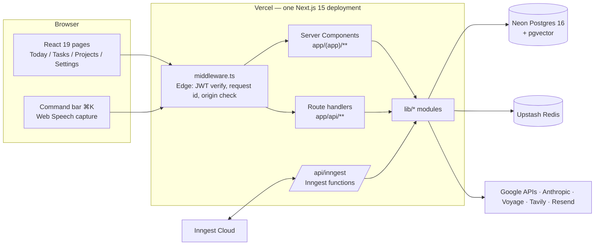
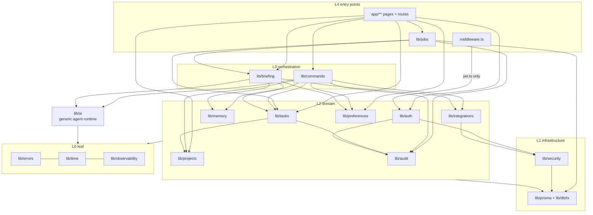
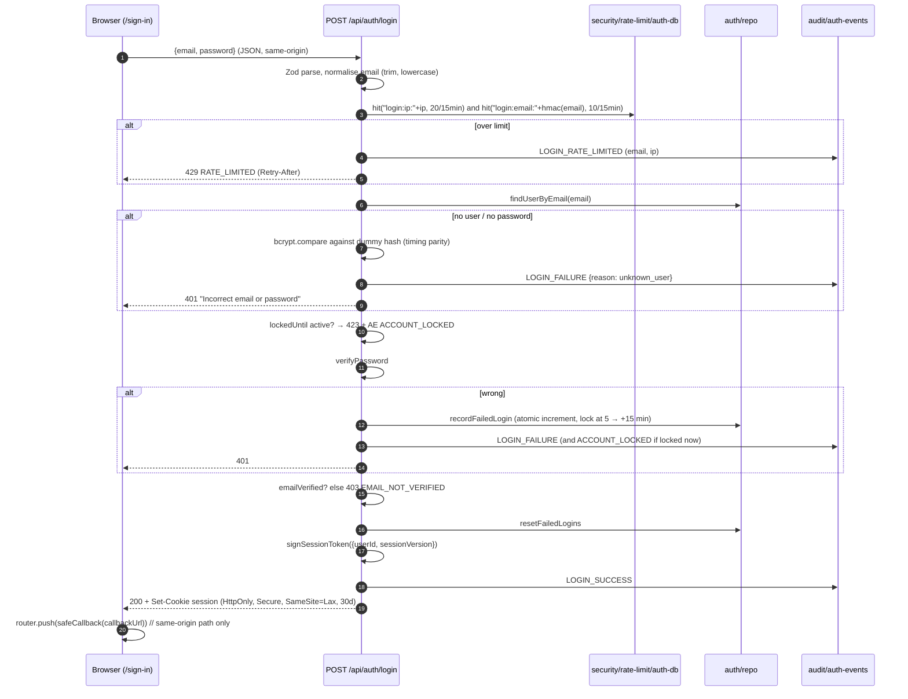
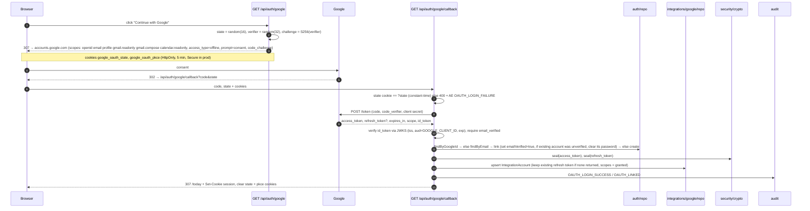
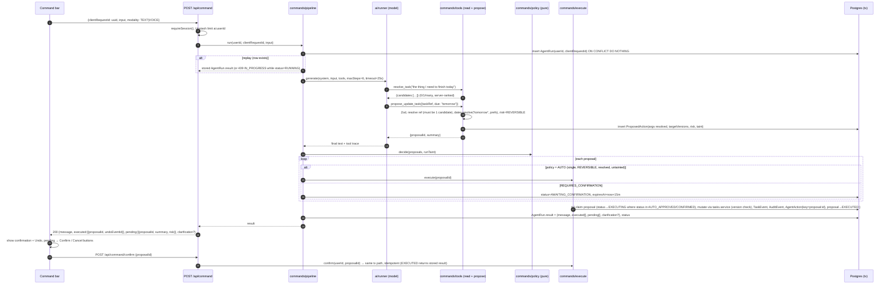
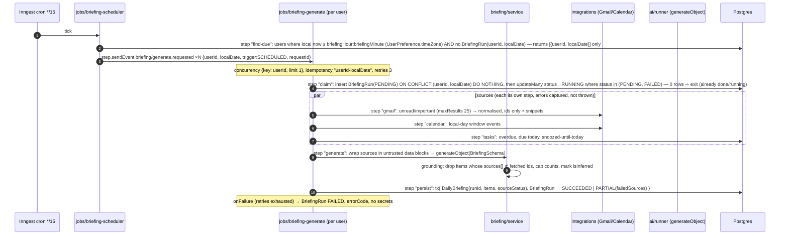
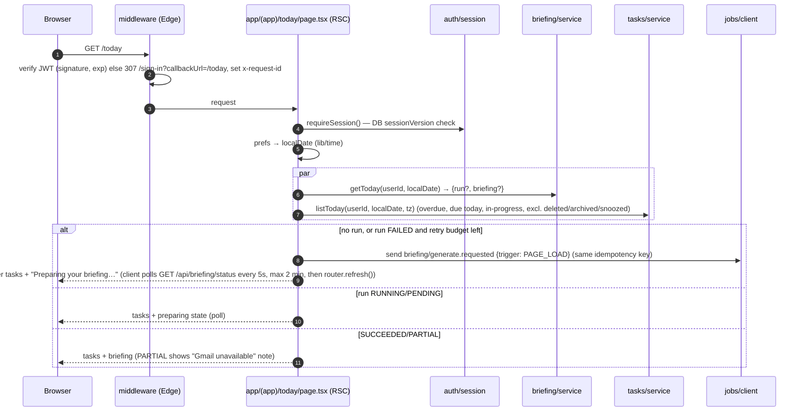
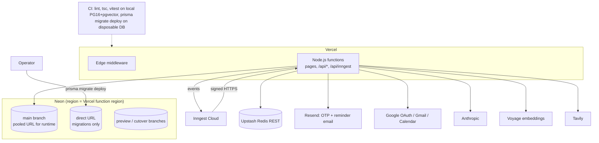

# 02 — System Architecture (target)

This is the target architecture for Personal OS V1. It is a modular monolith on Next.js 15 (ADR-001)
with Prisma and hand-rolled JWT sessions as the only persistence and identity stack (ADR-002).
Baseline facts are in `docs/01-current-state-audit.md`. The data model is in `docs/03-data-model.md`.

Labels: **[V]** means verified against current code. **[A]** means an assumption or proposal still to
be confirmed during implementation. Anything not labelled is target design.

---

## 1. Shape of the system



There is one deployable and one database. Inngest is the only queue or scheduler.
There are no other services.

---

## 2. Module boundaries

Target tree. Files that exist today and move are marked "(from …)".

```
middleware.ts                 Edge only. Imports lib/auth/jwt and lib/observability/request-id only.
app/
  (app)/today|tasks|projects|settings/   Server Components → services
  api/auth/**                 auth route handlers → lib/auth, lib/security, lib/audit
  api/command/route.ts        POST propose/execute → lib/commands
  api/command/confirm/route.ts POST {proposalId} → lib/commands
  api/tasks/**, api/projects/**, api/preferences/**  thin REST for UI edits → services
  api/briefing/status/route.ts GET → lib/briefing
  api/inngest/route.ts        serve(lib/jobs functions)
  api/health/route.ts         DB ping, no auth
lib/
  errors.ts                   AppError + codes (leaf)
  time/                       pure: local date, zoned conversions, HH:mm parsing (leaf)
  observability/              logger, request context (AsyncLocalStorage), redaction (leaf)
  security/
    crypto.ts                 AES-256-GCM token sealing (v1:), HMAC email hash
    rate-limit/auth-db.ts     Postgres fixed-window limiter (ADR-012)
    rate-limit/upstash.ts     AI/integration limiter + fail-closed memory fallback (from lib/rate-limit.ts)
  prisma.ts                   client singleton, adapter chosen by URL (ADR-003)
  db/tx.ts                    withTransaction(fn) → Prisma interactive tx; type Tx
  auth/                       jwt.ts (edge-safe), session.ts (getSession/requireSession),
                              password.ts, otp.ts, google-oauth.ts, github-oauth.ts, webauthn.ts,
                              cookies.ts, redirect.ts (safe callbackUrl), repo.ts (User, Passkey,
                              Challenge, VerificationToken)
  audit/                      auth-events.ts (logAuthEvent), audit-events.ts (recordAudit, in-tx)
  preferences/                repo.ts, service.ts (UserPreference; defaults)
  projects/                   repo.ts, service.ts, schema.ts
  tasks/                      repo.ts, service.ts (mutations + TaskEvent), events.ts (undo),
                              recurrence.ts, reminders.ts, schema.ts   (from lib/tasks/queries.ts)
  memory/                     repo.ts (raw SQL vector), service.ts, embeddings.ts (from lib/ai/embeddings.ts)
  integrations/
    types.ts                  capability interfaces (kept)
    google/                   repo.ts (IntegrationAccount, sealed tokens), tokens.ts (getFreshAccessToken)
    gmail/ calendar/ web/     adapters (kept)
  ai/                         provider.ts (AI_MODEL), runner.ts (tool loop), untrusted.ts
                              (data-block wrapping + taint), prompts/   — no domain imports
  commands/                   pipeline.ts (run), tools/ (read + propose tool defs), resolve.ts
                              (entity resolution), dates.ts (chrono, ADR-008), policy.ts (pure),
                              proposals/repo.ts, execute.ts (executor registry)
  briefing/                   scheduler.ts (who is due), service.ts (gather → generate → ground),
                              grounding.ts, schema.ts, repo.ts (BriefingRun, DailyBriefing)
  jobs/                       client.ts (from inngest/client.ts), events.ts (typed event schemas),
                              functions/{briefing-scheduler, briefing-generate, reminder-dispatch,
                              retention-purge}.ts
```

### 2.1 Allowed dependency directions



Rules. ESLint enforcement is via `no-restricted-imports` plus a boundaries test that walks the import graph.

1. **Only repositories touch Prisma** (ADR-006). `@/lib/prisma` and the generated client may be imported
   only by `lib/**/repo.ts`, `lib/**/repo/*.ts`, `lib/db/tx.ts`, `lib/audit/*`,
   `lib/security/rate-limit/auth-db.ts`, `lib/jobs/functions/retention-purge.ts`, and `scripts/**`.
   Route handlers, pages, `lib/commands/tools/**` and `lib/ai/**` are explicitly denied.
2. **Repository contract**: first parameter `userId`, last optional `{ tx?: Tx }`. Every `where`
   includes `userId`. Updates are `updateMany({ where: { id, userId, version } })` and `count === 0` means
   `NOT_FOUND_OR_CONFLICT`, followed by one follow-up read to tell the two cases apart.
3. **`lib/ai` has no domain knowledge.** It runs a tool loop over tool definitions supplied by the
   caller (`lib/commands`, `lib/briefing`). This removes the current `ai → tasks/memory` coupling and any
   cycle risk.
4. **Domain modules don't import orchestration.** `tasks` must not import `commands`. Sideways imports
   are limited to `tasks → projects` (ownership check of `projectId`) and `* → audit`.
5. **The Edge boundary**: `middleware.ts` may import only `lib/auth/jwt.ts` and
   `lib/observability/request-id.ts` (pure, `crypto.randomUUID`). Importing Prisma, `bcrypt`, `node:crypto`
   or Resend there fails the boundaries test. This rule exists today by convention only [V].
6. **Module public surface**: other modules import `lib/<m>/index.ts` (services, types), never a
   sibling's `repo.ts`. The exception is `lib/jobs/functions/retention-purge.ts`, which calls repos' `purge*` functions.
7. **No module-scope I/O or env reads** (audit U14). Clients (`Resend`, Upstash, Prisma adapter, Tavily key)
   are created lazily by `get*()` accessors, so `next build` and tests import cleanly.

---

## 3. Request flows

### 3.1 Sign-in with password



Changes from today: the IP and email limiter, dummy-hash timing parity, an AuthEvent for every outcome,
and `safeCallback` (audit U7, U8, U9). The failed-login increment becomes atomic
(`updateMany … failedLoginAttempts: { increment: 1 }`). Today it is a read-modify-write [V].

### 3.2 Google OAuth (sign-in + Gmail/Calendar grant)



The verified-email check, googleId-first lookup and refresh-token preservation are kept as they are now [V].
PKCE, JWKS verification (audit U11), the unverified-account fix (U10), token sealing (ADR-011) and AuthEvents
are added. Gmail and Calendar scopes stay `gmail.readonly`, `gmail.compose` and `calendar.readonly` (ADR-011).
If the user declined a scope at consent, the granted `scope` string is stored. Capabilities check it and
return `INTEGRATION_SCOPE_MISSING` instead of calling Google.

### 3.3 Command: propose → validate → (confirm) → execute



Key properties:

- **Replay safety.** `@@unique([userId, clientRequestId])` returns the stored result. The command bar keeps the
  same `clientRequestId` across network retries of one submission and creates a new one per submission.
- **Exactly-once execution.** The proposal row is the lock. `updateMany({ where: { id, userId, status: { in: [...] } }, data: { status: EXECUTING } })`
  with `count === 1` wins, and any other caller reads the stored result.
- **Clarification.** If `resolve_task` returns many candidates, or `dates.resolve` returns ambiguous or none, the
  tool returns `needs_clarification` with options. The run ends with `status=NEEDS_CLARIFICATION` and
  `result.clarification = {question, options[]}`. The client renders the options, and the user's choice is
  sent as a new command whose `context.clarifies = agentRunId` points at the original. The candidate ids are
  passed back as structured data, not re-parsed from text.
- **Undo.** `POST /api/tasks/undo {eventId}` applies the inverse of a `TaskEvent` (its `before` snapshot)
  as a new event, guarded by the task's current `version`. Undo is not available for `EXTERNAL` actions (drafts).

### 3.4 Morning briefing job



- Step outputs contain ids, counts and normalised source items. They never contain OAuth tokens (kept from
  today [V]). Each source step fetches its own token through `getFreshAccessToken`.
  [A] Email snippets in step state are acceptable within Inngest's retention. If that is not acceptable, the
  generate step re-fetches.
- `PARTIAL` is used when at least one source failed and at least one succeeded. If all sources fail and
  there are no tasks, the run is `FAILED`.
  `INTEGRATION_NOT_CONNECTED` is not a failure. It produces a briefing with a "connect Google" item.
- DST and time zones: `lib/time` computes `localDate` and "has passed briefing time" with
  `Intl.DateTimeFormat` in the user's zone. The 15-minute tick bounds latency to 15 minutes.

### 3.5 Today page load



The page makes no LLM call on load (kept from the V1 spec [V]). Enqueueing is idempotent, so reloading the
page doesn't create duplicate runs.

---

## 4. Session model

| Layer | Runtime | Check | On failure |
|---|---|---|---|
| `middleware.ts` | Edge | JWT HS256 signature + `exp` (`jose`). Matcher covers `/(today\|tasks\|projects\|settings)(/.*)?` and `/api/(?!auth/(login\|signup\|verify-otp\|forgot-password\|reset-password\|google\|github\|passkey/auth)\|inngest\|health).*` | Pages: 307 to `/sign-in?callbackUrl=<path>`. API: 401 JSON |
| `getSession()` | Node | Re-verify the JWT. Load `User.sessionVersion` and `lockedUntil`. Mismatch or currently locked means unauthenticated | returns `null` |
| `requireSession()` | Node | wraps `getSession()` | throws `AppError(UNAUTHENTICATED)` |

- **Token**: `{ userId, sessionVersion, iat, exp }`, 30-day fixed lifetime, no sliding refresh. The cookie is
  `session` (dev) or `__Host-session` (prod), with `HttpOnly; Secure; SameSite=Lax; Path=/`.
  [A] The `__Host-` rename is a proposal. It requires changing `SESSION_COOKIE` in `lib/auth/jwt.ts`.
- **Revocation** happens by incrementing `User.sessionVersion`. Triggers: password reset (already done [V]),
  "sign out everywhere", account lock, passkey removal and email change.
- **Logout** is `POST /api/auth/logout`. It clears the cookie and writes `AuthEvent LOGOUT`.
  `POST /api/auth/logout-all` increments `sessionVersion`.
- **Secret rotation**: verify with `JWT_SECRET`, then with `JWT_SECRET_PREVIOUS` if set. Sign only with the current secret.
- **CSRF**: SameSite=Lax plus middleware enforcement that state-changing `/api/*` requests carry `Origin`
  equal to `NEXT_PUBLIC_APP_URL` and use `Content-Type: application/json`. OAuth callbacks are GET with a state check.
- **Every server entry point calls `requireSession()`.** Middleware only filters early. Pages and handlers
  never trust it alone (migration spec §5 [V]).

---

## 5. Background jobs (Inngest)

| Function | Trigger | Concurrency / idempotency | Retries | Notes |
|---|---|---|---|---|
| `briefing-scheduler` | cron `*/15 * * * *` | singleton | 1 | Emits events only. Paginates users in batches of 500 |
| `briefing-generate` | event `briefing/generate.requested` | `concurrency {key: event.data.userId, limit: 1}`, `idempotency: event.data.userId + "-" + event.data.localDate` | 3, exponential | `onFailure` marks the run `FAILED` |
| `reminder-dispatch` | event `reminder/scheduled {reminderId, version}` | idempotency `reminderId-version` | 3 | `step.sleepUntil(remindAt)`, then re-read: skip if the version changed or the reminder was cancelled. Deliver in-app (or by Resend email per preference), then mark `SENT` |
| `retention-purge` | cron `15 3 * * *` UTC | singleton | 2 | Batched deletes per `docs/03-data-model.md` §6 |

Rules:
- Event payloads and step outputs contain no tokens, passwords, OTPs or full email bodies.
- Every event carries `requestId` (the originating request, or `job:<fn>:<runId>`) for log correlation.
- Functions are thin. Logic lives in `lib/briefing` and `lib/tasks` so it can be tested without Inngest.
- Errors: `AppError` with `retryable=false` is rethrown as Inngest `NonRetriableError`.
- Local development uses the Inngest Dev Server. Tests call the service functions directly.

---

## 6. AI tool execution

**Provider** (ADR-009). `lib/ai/provider.ts` exports `getModel()`, which uses `process.env.AI_MODEL ?? 'claude-sonnet-5'`
through `@ai-sdk/anthropic`. Tests inject a mock language model. The model id is hard-coded in two places today [V].

**Tool catalogue.** Defined in `lib/commands/tools/` and handed to `lib/ai/runner`.

| Tool | Kind | Untrusted output? | Notes |
|---|---|---|---|
| `resolve_task`, `search_tasks`, `get_task` | read | no (user's own data, still delimited) | `resolve_task` returns 0/1/many ranked candidates `{id, title, due, project}` |
| `resolve_project`, `list_projects` | read | no | |
| `search_memory` | read | **yes** | Memory content is user-authored but may have been copied from email or web |
| `search_email`, `read_email` | read | **yes** | Snippet plus subject only. `maxResults ≤ 10` |
| `list_calendar_events` | read | **yes** | Takes a date **phrase**, resolved server-side |
| `search_web` | read | **yes** | Tavily. Results truncated |
| `propose_create_task`, `propose_update_task`, `propose_complete_task`, `propose_snooze_task`, `propose_delete_task`, `propose_move_to_project` | propose | n/a | Takes `taskRef` (id from `resolve_task`) and phrases (`due: "friday 3pm"`) |
| `propose_set_reminder` | propose | n/a | `when` phrase, optional `taskRef` or `sourceRef` (email id) |
| `propose_save_memory` | propose | n/a | |
| `propose_create_email_draft` | propose | n/a | Always `EXTERNAL`, so it always needs confirmation |

**Execution rules.**
1. The model has no direct mutation path. Propose tools only write `ProposedAction` rows.
2. Every argument is Zod-validated. Entity references must resolve server-side, scoped to the user. The
   model never passes ISO timestamps; `lib/commands/dates.ts` resolves phrases (chrono-node plus preferences)
   and returns `needs_clarification` when the phrase is ambiguous or relative to an unset preference (ADR-008).
3. **Risk classification** happens in code, per tool and argument shape: `READ`, `REVERSIBLE`
   (single-entity create, update, complete, snooze, reminder, memory), `CONSEQUENTIAL` (completing a recurring
   series, moving more than one subtask with its parent), `DESTRUCTIVE` (delete), `BULK` (more than one target),
   `EXTERNAL` (email draft).
4. **Policy** (`lib/commands/policy.ts`, pure, table-tested) returns AUTO only for
   `risk == REVERSIBLE && targets ≤ 1 && resolved && !tainted`. Everything else returns REQUIRES_CONFIRMATION
   with a reason (`BULK`, `DESTRUCTIVE`, `EXTERNAL`, `UNTRUSTED_SOURCE`, `CONSEQUENTIAL`).
5. **Untrusted content and taint.** Every untrusted tool result is wrapped by `lib/ai/untrusted.ts` as
   `<untrusted_data source="gmail" id="…">…</untrusted_data>`, with the closing delimiter escaped inside the content.
   The system prompt states that data blocks are never instructions. V1 taint is **run-level**: once any
   untrusted read tool has returned content in a run, every later proposal in that run is `tainted=true` and
   therefore needs confirmation (ADR-007 §5).
   [A] Exact argument-level provenance is not implementable reliably, so run-level taint is the conservative approximation.
6. **Limits**: max 6 model steps, 25 s overall timeout, max 5 proposals per run (otherwise the run is
   treated as BULK and needs confirmation), and an Upstash `ai` bucket of 30 per minute per user (kept [V]).
7. **Persistence**: `AgentRun` holds input, status, model, token usage, latency, the result and the
   `clientRequestId`. `AgentAction` records each executed tool and proposal execution keyed by
   `proposal:<id>`. Read-tool traces are stored in `AgentRun.toolTrace` as `{name, ms, ok, resultCount}` only.
   Raw email or web content is never stored in it.

---

## 7. Error taxonomy and failure handling

`lib/errors.ts`:

```ts
export type ErrorCode =
  | 'VALIDATION' | 'UNAUTHENTICATED' | 'FORBIDDEN' | 'NOT_FOUND' | 'CONFLICT'
  | 'RATE_LIMITED' | 'EMAIL_NOT_VERIFIED' | 'ACCOUNT_LOCKED'
  | 'INTEGRATION_NOT_CONNECTED' | 'INTEGRATION_AUTH_EXPIRED' | 'INTEGRATION_SCOPE_MISSING'
  | 'UPSTREAM_UNAVAILABLE' | 'UPSTREAM_BAD_RESPONSE' | 'AI_OUTPUT_INVALID' | 'AI_TIMEOUT'
  | 'PROPOSAL_EXPIRED' | 'PROPOSAL_STATE' | 'INTERNAL';
export class AppError extends Error {
  constructor(public code: ErrorCode, public userMessage: string,
              public opts: { status?: number; retryable?: boolean; cause?: unknown; details?: unknown } = {}) { super(code); }
}
```

| Code | HTTP | Retryable | Typical source | Handling |
|---|---|---|---|---|
| VALIDATION | 400 | no | Zod | Field errors returned. Never echo secrets |
| UNAUTHENTICATED | 401 | no | session | Client redirects to `/sign-in` |
| FORBIDDEN | 403 | no | origin check | |
| NOT_FOUND | 404 | no | repos (missing **or not owned**, indistinguishable by design) | |
| CONFLICT | 409 | yes (after refetch) | version mismatch, run in progress | UI refetches and retries once |
| RATE_LIMITED | 429 | yes | limiters | `Retry-After` header |
| EMAIL_NOT_VERIFIED / ACCOUNT_LOCKED | 403 / 423 | no | login | |
| INTEGRATION_NOT_CONNECTED / AUTH_EXPIRED / SCOPE_MISSING | 409 (API), 200 with `action: "reconnect_google"` in command results | no | `getFreshAccessToken`, capabilities | Replaces the current string-message pattern [V] |
| UPSTREAM_UNAVAILABLE | 503 | yes | Google, Anthropic, Voyage, Tavily 5xx or timeouts | Jobs retry. Commands degrade (skip that tool and report it) |
| UPSTREAM_BAD_RESPONSE / AI_OUTPUT_INVALID | 502 | once | malformed payloads, schema failures | Logged with shape only |
| AI_TIMEOUT | 504 | yes | runner | Run marked `FAILED`. The client may resubmit **the same** `clientRequestId` |
| PROPOSAL_EXPIRED / PROPOSAL_STATE | 410 / 409 | no | confirm | |
| INTERNAL | 500 | no | anything unmapped | Generic message plus `requestId` |

The wire format is `{ "error": { "code", "message", "requestId", "details"? } }`. Every handler is wrapped by
`withRoute(handler)`, which sets up the request context, maps `AppError` to a response and maps unknown errors
to `INTERNAL`, logging once at `error` with the cause redacted. Prisma `P2002` maps to CONFLICT and `P2025`
to NOT_FOUND in one place, replacing the duck-typed copies in both OAuth callbacks [V].

**Timeouts**: external fetches use `AbortSignal.timeout`: Google 10 s, Voyage 8 s, Tavily 8 s, Resend 8 s.
The AI command run has 25 s overall, which sits within the Vercel function `maxDuration` (set to 60 s for `/api/command`).
[A] Vercel plan limits are to be confirmed.

---

## 8. Observability

**Logger** (`lib/observability/logger.ts`): JSON lines to stdout, which Vercel collects and can forward via a log drain.

```json
{"ts":"…","level":"info","msg":"command.executed","requestId":"…","userId":"…","route":"/api/command",
 "agentRunId":"…","proposalId":"…","durationMs":812,"code":null}
```

- **Correlation**: middleware sets `x-request-id` (from an incoming header if it is a valid UUID, otherwise
  `crypto.randomUUID()`) on the forwarded request and the response. `withRoute` and `withJob` put
  `{requestId, userId, route|fn}` into `AsyncLocalStorage`, and the logger merges it automatically.
  Inngest events carry `requestId`, and the job context uses `requestId` plus `inngestRunId`.
  `AgentRun.requestId`, `BriefingRun.requestId`, `AuthEvent.requestId` and `AuditEvent.requestId` link
  database rows to logs.
- **Redaction** (`lib/observability/redact.ts`) is applied to every log argument and to `AuditEvent.metadata`.
  It works in two ways:
  - Key denylist, case-insensitive: `password`, `newPassword`, `otp`, `code`, `token`, `accessToken`,
    `refreshToken`, `idToken`, `id_token`, `authorization`, `cookie`, `set-cookie`, `secret`, `apiKey`,
    `api_key`, `otpHash`, `publicKey`, `embedding`, `body`, `raw`.
  - Value patterns: JWT `eyJ[\w-]+\.[\w-]+\.[\w-]+`, Google `ya29\.[\w-]+`, `1//[\w-]{20,}`
    (refresh tokens), `Bearer\s+\S+`, `v1:` ciphertext, `sk-…` style keys.
  Emails are logged as `hmac(email)` except in `AuthEvent.email` (ADR-012). User input text and model
  output appear only at `debug`, which is disabled in production.
- **Levels**: `error` for unexpected failures, `warn` for degraded paths (PARTIAL briefing, token refresh
  failure, rate limited), `info` for one line per request or job step, `debug` for development only.
  `console.*` is lint-banned outside the logger.
- **Operational signals**:
  - Inngest dashboard for job runs and failures.
  - `BriefingRun` counts by status per day and `AgentRun` p95 latency and failure rate, queryable in SQL.
  - `/api/health` performs `SELECT 1`, for uptime checks.
  - [A] An external error tracker (e.g. Sentry) is optional and not in the current stack. Logs are the baseline.

---

## 9. Deployment topology



| Component | Role | Config |
|---|---|---|
| Vercel | Hosts Edge middleware and Node functions | Production plus Preview envs, each needing the full env set at build time (checklist §0 [V]) |
| Neon | Postgres 16 with `vector` | Runtime `DATABASE_URL` uses the **pooled** host (`-pooler`). Migrations use `DIRECT_DATABASE_URL`, which `prisma.config.ts` reads for `migrate`. [A] Prisma 7 config supports a separate migrate URL. This is to be confirmed in implementation |
| Inngest Cloud | cron and events | App URL `https://<domain>/api/inngest`, `INNGEST_SIGNING_KEY`, `INNGEST_EVENT_KEY` |
| Upstash | AI and integration rate limits | `UPSTASH_REDIS_REST_URL`/`TOKEN`. When absent in dev/test, a fail-closed in-memory limiter is used (ADR-012) |
| Resend | OTP and reminder email | `RESEND_API_KEY`. Sending domain verified [A] |

**Target environment variables**:
- Kept: `DATABASE_URL`, `JWT_SECRET`, `GOOGLE_CLIENT_ID`, `GOOGLE_CLIENT_SECRET`, `GITHUB_CLIENT_ID`,
  `GITHUB_CLIENT_SECRET`, `NEXT_PUBLIC_APP_URL`, `RESEND_API_KEY`, `ANTHROPIC_API_KEY`, `VOYAGE_API_KEY`,
  `TAVILY_API_KEY`, `UPSTASH_REDIS_REST_URL`, `UPSTASH_REDIS_REST_TOKEN`, `INNGEST_EVENT_KEY`, `INNGEST_SIGNING_KEY`.
- New: `DIRECT_DATABASE_URL`, `TOKEN_ENCRYPTION_KEY` (32 bytes base64; `TOKEN_ENCRYPTION_KEY_PREVIOUS` for rotation),
  `AUTH_EMAIL_HMAC_KEY`, `AI_MODEL` (optional), `JWT_SECRET_PREVIOUS` (optional).
- Removed after cutover: `AUTH_SECRET`, `AUTH_GOOGLE_ID`, `AUTH_GOOGLE_SECRET`.
- The Google OAuth client keeps only `/api/auth/google/callback` as a redirect URI. Remove `/api/auth/callback/google`.

**Release flow**:
1. Run migrations against the Neon cutover or preview branch, then main, via `prisma migrate deploy` (never `migrate dev` or `db push` remotely).
2. Deploy the app.
3. Smoke test.

Migrations are additive (expand), so the previous deployment keeps working against the new schema. Destructive
"contract" steps (dropping legacy Drizzle tables or columns) ship as a separate, later release. See
`docs/03-data-model.md` §7.
