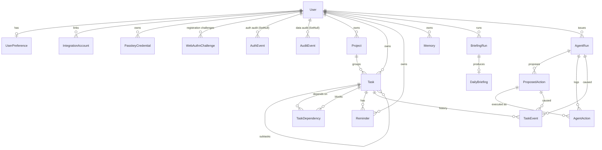
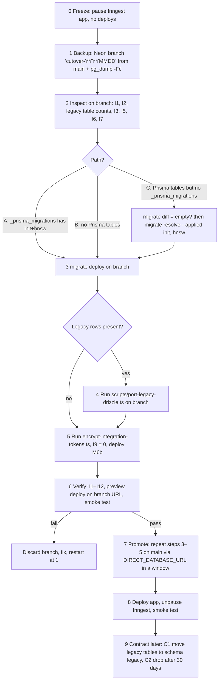

# 03 — Data Model and Migration Strategy (target)

This is the target Prisma data model for Personal OS V1. It implements ADR-005 (tasks), ADR-006 (ownership),
ADR-007 (command pipeline), ADR-010 (briefing), ADR-011 (encrypted tokens) and ADR-012 (auth audit and rate limiting).
The baseline is in `docs/01-current-state-audit.md` §5.1, and the module ownership of each table is in `docs/02-system-architecture.md` §2.

Labels: **[V]** means verified against the current schema or migrations. **[A]** means an assumption to confirm in implementation.

---

## 1. Conventions

- **Naming**: Prisma model names are PascalCase singular with camelCase columns and no `@@map`. Existing tables
  already use this form (`"Task"`, `"userId"`) [V], and changing it now would mean renaming every table.
- **IDs**: `String @id @default(cuid())`, matching the existing models [V]. `PasskeyCredential.id` is the
  WebAuthn credential id (base64url). When legacy Drizzle rows are ported (§7.5), their UUIDs are kept as text ids.
- **Time**: `DateTime` maps to `timestamp(3)` without time zone, holding **UTC by convention**. Prisma
  always writes UTC [V: existing columns]. User-local concepts are stored explicitly:
  - `localDate` columns (`@db.Date`) hold a calendar date in the user's zone.
  - `timeZone` columns hold an IANA name.
  - Date-only task deadlines are `dueAt` at `00:00:00.000Z` of the calendar date with `dueHasTime=false`.
    That value is a floating date and is never shifted by a time zone.
- **Ownership**: every user-owned row carries `userId`, including child tables such as `TaskEvent`,
  `TaskDependency` and `AgentAction`. Repos can then scope every query with a single-table `where` (ADR-006).
- **Optimistic concurrency**: mutable user-facing aggregates (`Task`, `Project`, `Reminder`, `UserPreference`)
  carry `version Int @default(1)`. Every update is `updateMany({ where: { id, userId, version } , data: { …, version: { increment: 1 } } })`.
- **Raw-SQL objects**: some objects can't be expressed in Prisma (vector index, partial unique indexes, CHECKs).
  They live in hand-written migration SQL and are listed in §5.3. Any new migration generated by
  `prisma migrate dev` must be reviewed and must **not** drop them. CI runs a drift check (§7.6).

---

## 2. Full model listing (`prisma/schema.prisma`, target)

```prisma
generator client {
  provider = "prisma-client"
  output   = "../lib/generated/prisma"
}

datasource db {
  provider = "postgresql"
}

// ───────────────────────────── Identity ─────────────────────────────

model User {
  id                  String               @id @default(cuid())
  email               String               @unique            // stored lower-cased (normalised in auth/repo)
  emailVerified       Boolean              @default(false)
  password            String?                                 // bcrypt(12) hash; null for OAuth/passkey-only users
  googleId            String?              @unique
  githubId            String?              @unique
  name                String?
  image               String?
  sessionVersion      Int                  @default(0)
  failedLoginAttempts Int                  @default(0)
  lockedUntil         DateTime?
  createdAt           DateTime             @default(now())
  updatedAt           DateTime             @updatedAt

  preference          UserPreference?
  integrationAccounts IntegrationAccount[]
  passkeyCredentials  PasskeyCredential[]
  webAuthnChallenges  WebAuthnChallenge[]
  authEvents          AuthEvent[]
  auditEvents         AuditEvent[]
  projects            Project[]
  tasks               Task[]
  taskDependencies    TaskDependency[]
  taskEvents          TaskEvent[]
  reminders           Reminder[]
  memories            Memory[]
  briefingRuns        BriefingRun[]
  dailyBriefings      DailyBriefing[]
  agentRuns           AgentRun[]
  proposedActions     ProposedAction[]
  agentActions        AgentAction[]
}

enum MotionPreference {
  SYSTEM   // follow prefers-reduced-motion
  REDUCE
  FULL
}

model UserPreference {
  userId              String           @id
  user                User             @relation(fields: [userId], references: [id], onDelete: Cascade)
  timeZone            String           @default("UTC")   // IANA; validated with Intl.supportedValuesOf('timeZone')
  locale              String           @default("en-US") // speech recognition + date parsing locale
  briefingHour        Int              @default(6)       // local wall-clock hour 0–23  (CHECK)
  briefingMinute      Int              @default(30)      // 0–59, default 06:30 local per ADR-010 (CHECK)
  workdayStart        String?                            // "HH:mm" local; null ⇒ "tomorrow morning" needs clarification (ADR-008)
  lunchEndsAt         String?                            // "HH:mm" local; null ⇒ "after lunch" needs clarification
  speechOutputEnabled Boolean          @default(false)   // speechSynthesis read-back (ADR-015)
  reducedMotion       MotionPreference @default(SYSTEM)  // per-user override of OS setting
  version             Int              @default(1)
  createdAt           DateTime         @default(now())
  updatedAt           DateTime         @updatedAt

  @@index([timeZone])                                    // scheduler groups users by zone
}

model PasskeyCredential {
  id         String    @id                               // WebAuthn credential id (base64url)
  userId     String
  user       User      @relation(fields: [userId], references: [id], onDelete: Cascade)
  publicKey  Bytes
  transports String[]
  counter    BigInt    @default(0)                        // WebAuthn signCount is uint32 (was Int)
  backedUp   Boolean   @default(false)
  deviceType String                                      // 'singleDevice' | 'multiDevice'
  aaguid     String?
  name       String?
  lastUsedAt DateTime?
  createdAt  DateTime  @default(now())

  @@index([userId])
}

enum WebAuthnPurpose {
  REGISTRATION
  AUTHENTICATION
}

model WebAuthnChallenge {
  id          String          @id @default(cuid())
  purpose     WebAuthnPurpose @default(REGISTRATION)      // existing rows were all registration [V]
  userId      String?                                     // set for REGISTRATION; null for discoverable AUTHENTICATION
  user        User?           @relation(fields: [userId], references: [id], onDelete: Cascade)
  challenge   String          @unique
  bindingHash String?                                     // sha256 of an httpOnly nonce cookie; required for AUTHENTICATION
  expiresAt   DateTime                                    // createdAt + 5 min
  createdAt   DateTime        @default(now())

  @@index([expiresAt])
  @@index([userId, purpose])
  @@index([bindingHash])
}

enum VerificationType {
  SIGN_UP
  PASSWORD_RESET
}

model VerificationToken {
  id        String           @id @default(cuid())
  email     String
  type      VerificationType
  otpHash   String                                        // bcrypt(10) of 6-digit code; plaintext never stored
  payload   Json?
  attempts  Int              @default(0)                  // ≤ 5, reserved atomically [V]
  expiresAt DateTime                                      // createdAt + 10 min
  createdAt DateTime         @default(now())

  @@index([email, type, createdAt])                       // "newest unexpired for email+type" lookup
  @@index([expiresAt])                                    // purge
}

model RateLimitAttempt {
  key         String   @id                                // "<route>:ip:<ip>" | "<route>:email:<hmac>"
  count       Int      @default(1)
  windowStart DateTime @default(now())

  @@index([windowStart])
}

enum AuthEventType {
  SIGN_UP
  LOGIN_SUCCESS
  LOGIN_FAILURE
  ACCOUNT_LOCKED
  LOGOUT
  PASSWORD_RESET_REQUESTED
  PASSWORD_RESET_COMPLETED
  OAUTH_LINKED
  PASSKEY_ADDED
  PASSKEY_REMOVED
  // added (append-only enum growth):
  LOGIN_RATE_LIMITED
  OTP_SENT
  OTP_VERIFIED
  OTP_FAILED
  OAUTH_LOGIN_SUCCESS
  OAUTH_LOGIN_FAILURE
  PASSKEY_LOGIN_SUCCESS
  PASSKEY_LOGIN_FAILURE
  SESSIONS_REVOKED
  INTEGRATION_CONNECTED
  INTEGRATION_DISCONNECTED
}

model AuthEvent {
  id        String        @id @default(cuid())
  type      AuthEventType
  userId    String?
  user      User?         @relation(fields: [userId], references: [id], onDelete: SetNull)
  email     String?                                       // ADR-012: stored; scrubbed on account deletion
  ip        String?
  userAgent String?
  requestId String?
  metadata  Json?                                         // redacted; never passwords/OTPs/tokens
  createdAt DateTime      @default(now())

  @@index([userId, createdAt])
  @@index([type, createdAt])
  @@index([email, createdAt])
  @@index([createdAt])                                    // retention purge
}

// ─────────────────────────── Integrations ───────────────────────────

enum IntegrationStatus {
  ACTIVE
  NEEDS_REAUTH      // refresh failed / revoked
  DISCONNECTED
}

model IntegrationAccount {
  id                String            @id @default(cuid())
  userId            String
  user              User              @relation(fields: [userId], references: [id], onDelete: Cascade)
  provider          String                                // "google" (unchanged storage) [V]
  providerAccountId String?                               // Google `sub`; backfilled from User.googleId
  accountEmail      String?
  accessToken       String                                // ADR-011 ciphertext "v1:<iv>:<tag>:<ct>" (base64url)
  refreshToken      String?                               // same format
  scopes            String                                // space-delimited, as granted
  expiresAt         DateTime?
  status            IntegrationStatus @default(ACTIVE)
  lastRefreshedAt   DateTime?
  lastErrorCode     String?                               // e.g. "invalid_grant"; never response bodies
  lastErrorAt       DateTime?
  createdAt         DateTime          @default(now())
  updatedAt         DateTime          @default(now()) @updatedAt

  @@unique([userId, provider])
  @@index([provider, status])                             // briefing scheduler: who has an active Google link
}

// ───────────────────────────── Planning ─────────────────────────────

model Project {
  id          String    @id @default(cuid())
  userId      String
  user        User      @relation(fields: [userId], references: [id], onDelete: Cascade)
  name        String
  description String?
  color       String?                                     // token name from the design system, not hex
  sortOrder   Int       @default(0)
  archivedAt  DateTime?
  deletedAt   DateTime?
  version     Int       @default(1)
  createdAt   DateTime  @default(now())
  updatedAt   DateTime  @updatedAt
  tasks       Task[]

  @@index([userId, archivedAt])
  // raw SQL: UNIQUE ("userId", lower("name")) WHERE "deletedAt" IS NULL  — §5.3
}

enum TaskStatus {
  INBOX
  TODO
  IN_PROGRESS
  DONE
  CANCELLED
}

enum TaskSource {
  MANUAL
  COMMAND
  VOICE
  EMAIL
  BRIEFING
}

model Task {
  id                 String     @id @default(cuid())
  userId             String
  user               User       @relation(fields: [userId], references: [id], onDelete: Cascade)
  projectId          String?
  project            Project?   @relation(fields: [projectId], references: [id], onDelete: SetNull)
  parentId           String?
  parent             Task?      @relation("Subtasks", fields: [parentId], references: [id], onDelete: SetNull)
  subtasks           Task[]     @relation("Subtasks")
  title              String
  description        String?                              // renamed from `notes` (data preserved, §7.2 M3)
  status             TaskStatus @default(TODO)
  priority           Int        @default(0)               // 0 NONE · 1 LOW · 2 MEDIUM · 3 HIGH · 4 URGENT (CHECK 0..4)
  dueAt              DateTime?                            // renamed from `dueDate`
  dueHasTime         Boolean    @default(false)           // false ⇒ dueAt is a floating calendar date at 00:00Z
  startAt            DateTime?
  timeZone           String?                              // IANA zone the user was in when dueAt/startAt was set
  estimateMinutes    Int?                                 // CHECK > 0
  tags               String[]   @default([])              // lower-cased, deduplicated by service
  recurrenceRule     String?                              // RFC 5545 RRULE subset (lib/tasks/recurrence.ts)
  recurrenceSeriesId String?                              // shared by all occurrences of a series
  snoozedUntil       DateTime?
  source             TaskSource @default(MANUAL)
  sourceRef          String?                              // gmail thread id / calendar event id
  completedAt        DateTime?
  archivedAt         DateTime?
  deletedAt          DateTime?                            // soft delete (undo); purged after 30 d
  version            Int        @default(1)
  createdAt          DateTime   @default(now())
  updatedAt          DateTime   @updatedAt

  dependencies       TaskDependency[] @relation("TaskDependsOn")    // edges where this task waits on others
  dependents         TaskDependency[] @relation("TaskBlocks")       // edges where others wait on this task
  reminders          Reminder[]
  events             TaskEvent[]

  @@index([userId, status, dueAt])                        // Today/list: open tasks by due date
  @@index([userId, deletedAt])                            // trash view + purge
  @@index([userId, projectId])
  @@index([userId, updatedAt])                            // recently changed / sync
  @@index([userId, snoozedUntil])
  @@index([parentId])
  @@index([recurrenceSeriesId])
  @@index([userId, source, sourceRef])                    // "is there already a task for this email?"
  @@index([tags], type: Gin)
}

model TaskDependency {
  taskId      String
  task        Task     @relation("TaskDependsOn", fields: [taskId], references: [id], onDelete: Cascade)
  dependsOnId String
  dependsOn   Task     @relation("TaskBlocks", fields: [dependsOnId], references: [id], onDelete: Cascade)
  userId      String                                      // both tasks must belong to this user (service-enforced)
  user        User     @relation(fields: [userId], references: [id], onDelete: Cascade)
  createdAt   DateTime @default(now())

  @@id([taskId, dependsOnId])
  @@index([dependsOnId])                                  // "what does completing X unblock?"
  @@index([userId])
  // raw SQL: CHECK ("taskId" <> "dependsOnId"); cycles rejected in lib/tasks/service.ts
}

enum ReminderStatus {
  PENDING
  SENT
  CANCELLED
  FAILED
}

enum ReminderChannel {
  IN_APP
  EMAIL
}

model Reminder {
  id         String          @id @default(cuid())
  userId     String
  user       User            @relation(fields: [userId], references: [id], onDelete: Cascade)
  taskId     String?                                      // null ⇒ standalone ("the recruiter email")
  task       Task?           @relation(fields: [taskId], references: [id], onDelete: Cascade)
  title      String                                       // what to show when it fires
  sourceRef  String?                                      // e.g. gmail message id
  remindAt   DateTime
  channel    ReminderChannel @default(IN_APP)
  status     ReminderStatus  @default(PENDING)
  sentAt     DateTime?
  seenAt     DateTime?                                    // in-app acknowledgement
  attempts   Int             @default(0)
  lastError  String?                                      // error code only
  version    Int             @default(1)                  // bumped on reschedule; dispatch skips stale versions
  createdAt  DateTime        @default(now())
  updatedAt  DateTime        @updatedAt

  @@index([userId, status, remindAt])                     // "upcoming reminders" UI
  @@index([status, remindAt])                             // safety sweep for missed dispatches
  @@index([taskId])
}

enum ActorType {
  USER        // direct UI action
  AGENT       // executed proposal from the command pipeline
  SYSTEM      // jobs: recurrence roll-over, purge, migration import
}

enum TaskEventType {
  IMPORTED            // synthetic baseline written by the v2 migration
  CREATED
  UPDATED             // field changes (title, description, due, priority, tags, estimate, start)
  STATUS_CHANGED
  COMPLETED
  REOPENED
  SNOOZED
  MOVED               // project or parent change
  ARCHIVED
  UNARCHIVED
  DELETED             // soft delete
  RESTORED
  DEPENDENCY_ADDED
  DEPENDENCY_REMOVED
  REMINDER_SET
  REMINDER_CLEARED
  RECURRENCE_ROLLED   // next occurrence generated
  UNDONE              // inverse applied; revertsEventId set
}

model TaskEvent {
  id               String        @id @default(cuid())
  userId           String
  user             User          @relation(fields: [userId], references: [id], onDelete: Cascade)
  taskId           String
  task             Task          @relation(fields: [taskId], references: [id], onDelete: Cascade)
  type             TaskEventType
  actorType        ActorType
  agentRunId       String?
  agentRun         AgentRun?     @relation(fields: [agentRunId], references: [id], onDelete: SetNull)
  proposedActionId String?
  proposedAction   ProposedAction? @relation(fields: [proposedActionId], references: [id], onDelete: SetNull)
  revertsEventId   String?                                // for UNDONE
  before           Json?                                  // changed fields only, pre-image
  after            Json?                                  // changed fields only, post-image
  taskVersion      Int                                    // Task.version after this event
  requestId        String?
  createdAt        DateTime      @default(now())

  @@index([taskId, createdAt])
  @@index([userId, createdAt])                            // activity feed / undo stack
  @@index([proposedActionId])
  // append-only: repos expose insert + read only; no update/delete except purge cascade
}

// ───────────────────────────── Memory ─────────────────────────────

enum MemorySource {
  COMMAND
  MANUAL
  IMPORTED
}

model Memory {
  id             String                      @id @default(cuid())
  userId         String
  user           User                        @relation(fields: [userId], references: [id], onDelete: Cascade)
  content        String
  embedding      Unsupported("vector(512)")?
  embeddingModel String                      @default("voyage-3-lite")
  source         MemorySource                @default(COMMAND)
  deletedAt      DateTime?
  createdAt      DateTime                    @default(now())
  updatedAt      DateTime                    @default(now()) @updatedAt

  @@index([userId, createdAt])
  // raw SQL: HNSW "Memory_embedding_hnsw_idx" USING hnsw (embedding vector_cosine_ops) — §5.3
}

// ───────────────────────────── Briefing ─────────────────────────────

enum BriefingRunStatus {
  PENDING
  RUNNING
  SUCCEEDED
  FAILED
  PARTIAL
}

enum BriefingTrigger {
  SCHEDULED
  PAGE_LOAD
  RETRY
  LEGACY       // backfilled from pre-v2 DailyBriefing rows
}

model BriefingRun {
  id             String            @id @default(cuid())
  userId         String
  user           User              @relation(fields: [userId], references: [id], onDelete: Cascade)
  localDate      DateTime          @db.Date               // user's calendar date
  timeZone       String                                   // snapshot used to compute localDate
  status         BriefingRunStatus @default(PENDING)
  trigger        BriefingTrigger
  attempts       Int               @default(0)
  failedSources  String[]          @default([])           // e.g. ["gmail"]
  sourceStatus   Json?                                    // {gmail:{ok,count,errorCode}, calendar:{…}, tasks:{…}}
  errorCode      String?
  model          String?
  inputTokens    Int?
  outputTokens   Int?
  inngestRunId   String?
  requestId      String?
  startedAt      DateTime?
  finishedAt     DateTime?
  createdAt      DateTime          @default(now())
  updatedAt      DateTime          @updatedAt
  briefing       DailyBriefing?

  @@unique([userId, localDate])                           // ADR-010: one run per user per local day
  @@index([status, updatedAt])                            // sweep stuck RUNNING
}

model DailyBriefing {
  id             String      @id @default(cuid())
  userId         String
  user           User        @relation(fields: [userId], references: [id], onDelete: Cascade)
  briefingRunId  String      @unique
  briefingRun    BriefingRun @relation(fields: [briefingRunId], references: [id], onDelete: Cascade)
  localDate      DateTime    @db.Date                     // was briefingDate TEXT (cast in M4)
  schemaVersion  Int         @default(2)                  // 1 = legacy string arrays, 2 = typed items
  items          Json                                     // v2: BriefingItem[] {kind,title,reason,sources[],isInferred}
  attentionItems Json?                                    // v1 legacy only; null for v2
  digestItems    Json?                                    // v1 legacy only; null for v2
  generatedAt    DateTime    @default(now())

  @@index([userId, localDate])
}

// ───────────────────────── Command pipeline ─────────────────────────

enum AgentRunStatus {
  RUNNING
  SUCCEEDED                // all proposals executed or none needed (as built; was COMPLETED)
  AWAITING_CONFIRMATION    // ≥1 proposal pending
  NEEDS_CLARIFICATION
  FAILED
  RATE_LIMITED
}

enum InputModality {
  TEXT
  VOICE
}

model AgentRun {
  id              String           @id @default(cuid())
  userId          String
  user            User             @relation(fields: [userId], references: [id], onDelete: Cascade)
  clientRequestId String?                                 // UUID from the client; null only on legacy rows
  clarifiesRunId  String?                                 // follow-up answer to a NEEDS_CLARIFICATION run
  input           String
  modality        InputModality    @default(TEXT)
  status          AgentRunStatus   @default(RUNNING)
  model           String?
  promptVersion   String?
  toolTrace       Json?                                   // [{name, ms, ok, resultCount}] — no raw content
  toolCalls       Json?                                   // legacy column (tool names), kept read-only
  result          Json?                                   // stored response for clientRequestId replay
  errorCode       String?
  latencyMs       Int?
  inputTokens     Int?
  outputTokens    Int?
  tokenCost       Int?                                    // legacy total tokens
  requestId       String?
  finishedAt      DateTime?
  createdAt       DateTime         @default(now())
  updatedAt       DateTime         @default(now()) @updatedAt
  proposals       ProposedAction[]
  actions         AgentAction[]
  taskEvents      TaskEvent[]

  @@unique([userId, clientRequestId])                     // ADR-007 replay; NULLs don't collide
  @@index([userId, createdAt])
  @@index([createdAt])                                    // 90-day purge
}

enum RiskClass {
  READ
  REVERSIBLE
  CONSEQUENTIAL
  DESTRUCTIVE
  BULK
  EXTERNAL
}

// As built (aligned with docs/04 §proposal lifecycle): auto-approval and
// "awaiting confirmation" are expressed by requiresConfirmation + PENDING.
enum ProposalStatus {
  PENDING                  // validated; waits for confirmation when requiresConfirmation
  NEEDS_CLARIFICATION
  EXECUTING                // claimed by an executor (lock)
  EXECUTED
  CANCELLED                // user cancelled
  EXPIRED
  FAILED
}

model ProposedAction {
  id                   String         @id @default(cuid())
  userId               String
  user                 User           @relation(fields: [userId], references: [id], onDelete: Cascade)
  agentRunId           String
  agentRun             AgentRun       @relation(fields: [agentRunId], references: [id], onDelete: Cascade)
  kind                 String                             // "task.update", "reminder.create", "email.draft", …
  args                 Json                               // server-resolved, Zod-validated (ids, ISO instants)
  summary              String                             // human text shown in confirm UI
  risk                 RiskClass
  targetIds            String[]       @default([])
  targetVersions       Json?                              // {taskId: version} for optimistic concurrency at execute
  tainted              Boolean        @default(false)     // untrusted content seen in this run (ADR-007 §5)
  untrustedSources     String[]       @default([])        // ["gmail:<id>", "web:<url-hash>"]
  requiresConfirmation Boolean
  confirmationReason   String?                            // BULK | DESTRUCTIVE | EXTERNAL | UNTRUSTED_SOURCE | CONSEQUENTIAL
  status               ProposalStatus @default(PROPOSED)
  expiresAt            DateTime                           // createdAt + 15 min
  confirmedAt          DateTime?
  executedAt           DateTime?
  result               Json?                              // executor output (e.g. {taskId, undoEventId})
  errorCode            String?
  createdAt            DateTime       @default(now())
  updatedAt            DateTime       @updatedAt
  actions              AgentAction[]
  taskEvents           TaskEvent[]

  @@index([userId, status, createdAt])                    // pending confirmations UI
  @@index([agentRunId])
  @@index([status, expiresAt])                            // expiry sweep
}

enum AgentActionStatus {
  SUCCESS
  ERROR
}

model AgentAction {
  id               String            @id @default(cuid())
  userId           String                                 // backfilled from AgentRun (M5)
  user             User              @relation(fields: [userId], references: [id], onDelete: Cascade)
  agentRunId       String
  agentRun         AgentRun          @relation(fields: [agentRunId], references: [id], onDelete: Cascade)
  proposedActionId String?
  proposedAction   ProposedAction?   @relation(fields: [proposedActionId], references: [id], onDelete: Cascade)
  toolName         String
  input            Json?
  output           Json?                                  // redacted; no embeddings/tokens
  idempotencyKey   String            @unique              // "proposal:<id>" for executions
  status           AgentActionStatus                      // was TEXT 'success'|'error' (M5 mapping)
  durationMs       Int?
  createdAt        DateTime          @default(now())

  @@index([agentRunId])
  @@index([userId, createdAt])
}

// ───────────────────────────── Audit ─────────────────────────────

model AuditEvent {
  id          String    @id @default(cuid())
  userId      String?                                     // owner of the affected data
  user        User?     @relation(fields: [userId], references: [id], onDelete: SetNull)
  actorType   ActorType
  action      String                                      // "task.update", "project.delete", "integration.disconnect", "preference.update", "memory.delete", "task.purge"
  entityType  String
  entityId    String?
  agentRunId  String?                                     // plain ids (no FK) so audit outlives 90-day AgentRun purge
  proposalId  String?
  requestId   String?
  metadata    Json?                                       // redacted diff summary
  createdAt   DateTime  @default(now())

  @@index([userId, createdAt])
  @@index([entityType, entityId])
  @@index([createdAt])
}
```

Prisma notes:
- `@@index([tags], type: Gin)` is supported for PostgreSQL in Prisma 5+ [A: re-check on 7.9].
- Prisma represents `@db.Date` as a JS `Date` at UTC midnight. `lib/time` converts it to and from `YYYY-MM-DD`.
- The upper bound on `priority` (`0..4`) is a CHECK constraint (§5.3).
- ADR-005 says "priority (0–3, `NONE/LOW/MEDIUM/HIGH/URGENT` mapped 0–4)". That gives five labels, so the
  range is 0–4. This document follows the label list, and the ADR wording should be corrected.

---

## 3. Relationships



Delete behaviour:
- Deleting a `User` cascades every owned table. `AuthEvent` and `AuditEvent` rows are `SetNull` and kept for
  their retention window, with `email`, `ip` and `userAgent` scrubbed in the same transaction (§6).
- Purging a `Task` cascades its events, dependencies and reminders.
- Purging an `AgentRun` (90 days) cascades its proposals and actions. `TaskEvent.agentRunId` and
  `TaskEvent.proposedActionId` become NULL, so task history survives.

---

## 4. Ownership rule per model

All access goes through `lib/<domain>/repo.ts` with `userId` as the first parameter (ADR-006).

| Model | Owner column | Rule | Repo module |
|---|---|---|---|
| User | `id` | Only `getSession().userId` is readable. Profile updates are limited to self | `lib/auth/repo.ts` |
| UserPreference | `userId` (PK) | `where: { userId }`. Created lazily with defaults on first read | `lib/preferences/repo.ts` |
| PasskeyCredential | `userId` | List, rename and remove scoped to `userId`. Auth lookup by `id` happens pre-session and must then match `userHandle → userId` | `lib/auth/repo.ts` |
| WebAuthnChallenge | `userId` (registration) or `bindingHash` (authentication) | Consumed only with a matching binding and purpose, single-use (`deleteMany` with `count === 1`) | `lib/auth/repo.ts` |
| VerificationToken | `email` (pre-account) | Lookup by `(email, type)`. Never exposed | `lib/auth/repo.ts` |
| RateLimitAttempt | none (keyed) | System table. Only `lib/security/rate-limit/auth-db.ts` | — |
| AuthEvent | `userId?` | Write-only from `lib/audit`. Users may read their own (security page) | `lib/audit/auth-events.ts` |
| AuditEvent | `userId?` | Write-only, inside the mutating transaction | `lib/audit/audit-events.ts` |
| IntegrationAccount | `userId` | `@@unique([userId, provider])`. Tokens are decrypted only inside `lib/integrations/google/tokens.ts`, and the repo never returns plaintext to other modules | `lib/integrations/google/repo.ts` |
| Project | `userId` | Scoped `updateMany` with `version` | `lib/projects/repo.ts` |
| Task | `userId` | Scoped `updateMany` with `version`. `projectId`/`parentId` must belong to the same `userId` (validated in the same tx). Default reads exclude `deletedAt IS NOT NULL` | `lib/tasks/repo.ts` |
| TaskDependency | `userId` | Both endpoints verified as owned by `userId` in the same tx, plus a cycle check | `lib/tasks/repo.ts` |
| Reminder | `userId` | `taskId` (if set) must be owned by the same user | `lib/tasks/reminders.ts` → repo |
| TaskEvent | `userId` | Insert and read only. Undo verifies `userId` and the current task version | `lib/tasks/repo.ts` |
| Memory | `userId` | Raw SQL must include `WHERE "userId" = $1` (vector search) | `lib/memory/repo.ts` |
| BriefingRun / DailyBriefing | `userId` | Read by `(userId, localDate)`. Written only by the job | `lib/briefing/repo.ts` |
| AgentRun | `userId` | Created by `(userId, clientRequestId)` | `lib/commands/runs/repo.ts` |
| ProposedAction | `userId` | Confirm is `updateMany({ where: { id, userId, status: AWAITING_CONFIRMATION, expiresAt: { gt: now } } })` | `lib/commands/proposals/repo.ts` |
| AgentAction | `userId` | Insert only | `lib/commands/runs/repo.ts` |

Cross-user isolation tests run against `aios_test`. For each repo, user B attempts read, update and delete
on user A's id and must receive `NOT_FOUND`, with A's row unchanged.

---

## 5. Indexes and unique constraints

### 5.1 Unique constraints

| Constraint | Why |
|---|---|
| `User.email`, `User.googleId`, `User.githubId` | One account per identity. OAuth linking relies on them [V] |
| `IntegrationAccount(userId, provider)` | One Google link per user. Upsert target [V] |
| `WebAuthnChallenge.challenge` | Challenge lookup and single use |
| `BriefingRun(userId, localDate)` | ADR-010: at most one briefing per user per local day. This is the claim lock |
| `DailyBriefing.briefingRunId` | 1:1 run to briefing |
| `AgentRun(userId, clientRequestId)` | ADR-007 replay safety |
| `AgentAction.idempotencyKey` | Exactly-once execution record per proposal [V: column exists] |
| `TaskDependency(taskId, dependsOnId)` (PK) | No duplicate edges |
| Project `("userId", lower(name)) WHERE "deletedAt" IS NULL` (raw) | Lets `resolve_project("Work")` be unambiguous, while still allowing a name to be reused after deletion |

### 5.2 Secondary indexes

Each index matches a specific query:
- `Task(userId,status,dueAt)`: Today and list views.
- `Task(userId,deletedAt)`: trash and purge.
- `Task(userId,updatedAt)`: recent changes.
- `Task(userId,snoozedUntil)`: un-snooze in Today.
- `Task(parentId)` and `Task(recurrenceSeriesId)`: tree and series operations.
- `Task(userId,source,sourceRef)`: duplicate-from-email check.
- `Task.tags` (GIN): tag filters.
- `Reminder(status,remindAt)`: dispatch safety sweep.
- `ProposedAction(userId,status,createdAt)`: pending confirmations.
- `ProposedAction(status,expiresAt)`: expiry.
- `AgentRun/AuthEvent/AuditEvent(createdAt)`: retention purges.
- `BriefingRun(status,updatedAt)`: stuck-run sweep.
- `UserPreference(timeZone)`: scheduler.
- `IntegrationAccount(provider,status)`: users eligible for a briefing.

### 5.3 Raw-SQL objects (not representable in Prisma)

| Object | Definition | Migration |
|---|---|---|
| `Memory_embedding_hnsw_idx` | `CREATE INDEX … ON "Memory" USING hnsw ("embedding" vector_cosine_ops)` | M1 |
| `Project_userId_name_active_key` | `CREATE UNIQUE INDEX … ON "Project" ("userId", lower("name")) WHERE "deletedAt" IS NULL` | M3 |
| `Task_priority_check` | `CHECK ("priority" BETWEEN 0 AND 4)` | M3 |
| `Task_estimate_check` | `CHECK ("estimateMinutes" IS NULL OR "estimateMinutes" > 0)` | M3 |
| `TaskDependency_no_self_check` | `CHECK ("taskId" <> "dependsOnId")` | M3 |
| `UserPreference_time_check` | `CHECK ("briefingHour" BETWEEN 0 AND 23 AND "briefingMinute" BETWEEN 0 AND 59 AND ("workdayStart" IS NULL OR "workdayStart" ~ '^([01]\d\|2[0-3]):[0-5]\d$') AND ("lunchEndsAt" IS NULL OR "lunchEndsAt" ~ '^([01]\d\|2[0-3]):[0-5]\d$'))` | M2 |
| `IntegrationAccount_token_format_check` | `CHECK ("accessToken" LIKE 'v1:%' AND ("refreshToken" IS NULL OR "refreshToken" LIKE 'v1:%'))`. As built: added (and validated) in M6b, after the encryption script (§7.4) and the sealed-token callbacks; not present in M6 | M6b |

---

## 6. Retention

The `retention-purge` job runs daily at 03:15 UTC (`docs/02-system-architecture.md` §5). It deletes in
batches of 1,000 by primary key, and each batch is its own transaction.

| Data | Rule | Mechanism |
|---|---|---|
| AgentRun (+ ProposedAction, AgentAction via cascade) | 90 days after `createdAt` | delete. TaskEvent refs set NULL |
| ProposedAction not executed | `AWAITING_CONFIRMATION` past `expiresAt` → `EXPIRED` | lazily on confirm, plus the daily sweep |
| AuthEvent | 1 year | delete |
| AuditEvent | 1 year [A: proposal, mirrors AuthEvent] | delete |
| WebAuthnChallenge | TTL 5 min. Consumed rows deleted immediately. Expired rows purged after `expiresAt < now − 1 h` | delete |
| VerificationToken | TTL 10 min. Purged after `expiresAt < now − 24 h` | delete |
| RateLimitAttempt | `windowStart < now − 24 h` | delete |
| Task soft-deleted | `deletedAt < now − 30 days` → hard delete (cascade events, deps, reminders), plus `AuditEvent task.purge` with the id only | delete |
| Project soft-deleted | 30 days, after its tasks are detached (SetNull) | delete |
| Memory soft-deleted | 30 days | delete |
| Reminder SENT/CANCELLED/FAILED | 90 days after `remindAt` | delete |
| BriefingRun + DailyBriefing | 180 days [A: proposal] | delete (cascade) |
| IntegrationAccount | On disconnect: revoke at Google (`oauth2.googleapis.com/revoke`), then delete the row immediately | delete |
| User deletion | Immediate cascade. In the same tx, AuthEvent and AuditEvent for that user get `email=NULL, ip=NULL, userAgent=NULL, metadata=NULL` | update + delete |

---

## 7. Migration strategy

### 7.1 Principles

1. **Prisma migrations are canonical from `20260825055217_init`** (ADR-004). They are applied with
   `prisma migrate deploy` only. Never run `db push` or `migrate reset` against a remote database.
2. **Changes are additive and expand-first.** Each migration either adds objects or transforms data in
   place while preserving it. Dropping legacy Drizzle tables is a separate, later, operator-gated step (§7.5 C2).
3. **Prisma's generated SQL is always hand-reviewed.** Prisma emits `DROP COLUMN` + `ADD COLUMN` for renames
   and type changes. Those statements must be replaced with `RENAME COLUMN` and `ALTER … USING` (M3, M4, M5).
4. **No secrets in SQL.** Token encryption is done by a TypeScript script that reads `TOKEN_ENCRYPTION_KEY`
   from the environment (§7.4).
5. Every migration can be re-run safely where Postgres allows it (`IF NOT EXISTS`, guarded `DO` blocks), so
   rehearsing on a branch and then applying to main behaves the same way.
6. **Enum additions** (`ALTER TYPE … ADD VALUE`) go in their own migration (M7), and no other statement in
   that file uses the new values.
   [A] This depends on how Prisma 7 wraps Postgres migrations in transactions. Isolating the change is safe either way.

### 7.2 Migration list (after `20260825055921_add_memories_hnsw_index`)

| # | Name | Contents |
|---|---|---|
| M1 | `…_fix_memory_hnsw_index` | Fix the HNSW name collision (audit §5.1). See the SQL below |
| M2 | `…_user_preferences` | Create `MotionPreference`, `UserPreference` and its CHECK. `INSERT INTO "UserPreference" ("userId", "updatedAt") SELECT id, now() FROM "User" ON CONFLICT DO NOTHING` |
| M3 | `…_task_model_v2` | Enums `TaskStatus`, `TaskSource`, `ActorType`, `TaskEventType`, `ReminderStatus`, `ReminderChannel`. Tables `Project`, `TaskDependency`, `Reminder`, `TaskEvent`. Task changes per the SQL below. CHECKs and the partial unique index |
| M4 | `…_briefing_runs` | Enums, `BriefingRun`, and the DailyBriefing transformation (SQL below) |
| M5 | `…_command_pipeline` | AgentRun columns and enums, `ProposedAction`, AgentAction `userId` backfill and status enum mapping |
| M6 | `…_integration_account_v2` | New columns (`providerAccountId`, `accountEmail`, `status`, `lastRefreshedAt`, `lastErrorCode`, `lastErrorAt`, `updatedAt`). Backfill `providerAccountId` (and `accountEmail`) from `User`. **As built:** no token CHECK here; the CHECK is added together with its validation in M6b, after the auth callbacks write sealed tokens |
| M6b | `…_validate_token_format` | `ALTER TABLE "IntegrationAccount" VALIDATE CONSTRAINT "IntegrationAccount_token_format_check"`. Deployed only after the encryption script reports 0 plaintext rows |
| M7 | `…_auth_event_types` | `ALTER TYPE "AuthEventType" ADD VALUE IF NOT EXISTS …` for each new value |
| M8 | `…_audit_and_auth_hardening` | `AuditEvent` table. AuthEvent `requestId` and indexes. `WebAuthnPurpose`, `WebAuthnChallenge.purpose`/`bindingHash`/unique `challenge` (delete expired, orphan and duplicate rows first), owner FK. `aaguid`. `VerificationToken` index change |
| M9 | `…_memory_v2` | `MemorySource`, `embeddingModel`, `source`, `deletedAt`, `updatedAt` (DEFAULT now()). Index `(userId, createdAt)` replaces `(userId)` |
| M7b | `20261021090900_auth_ws2_followups` | As built: `AuthEventType` += `PASSWORD_RESET_FAILED`, `CSRF_BLOCKED`; `PasskeyCredential.counter` INTEGER → BIGINT (moved here from M8) |

As-built file names: `20261021090000_fix_memory_hnsw_index` (M1) … `20261021090800_memory_v2` (M9), then M7b.
Verified by `prisma/__tests__/migrations.int.test.ts` (old-shape rows seeded at the init migration, both
HNSW paths) and `pnpm db:integrity` (`scripts/db-integrity.ts`, checks I1–I10 plus X1 "one open occurrence
per series" and X2 "tasks without history").

**M1: HNSW fix** (works on a fresh database and on one previously migrated by Drizzle):

```sql
DO $$
BEGIN
  -- Fresh DB: the init-era migration created memories_embedding_idx ON "Memory" → rename it.
  IF EXISTS (SELECT 1 FROM pg_indexes WHERE schemaname = current_schema()
             AND indexname = 'memories_embedding_idx' AND tablename = 'Memory') THEN
    ALTER INDEX "memories_embedding_idx" RENAME TO "Memory_embedding_hnsw_idx";
  END IF;
END $$;
-- Drizzle-era DB: memories_embedding_idx belongs to legacy "memories", so the previous
-- IF NOT EXISTS was a silent no-op and "Memory" has no vector index. Create it now.
CREATE INDEX IF NOT EXISTS "Memory_embedding_hnsw_idx"
  ON "Memory" USING hnsw ("embedding" vector_cosine_ops);
```

**M3: Task transformation** (excerpt, hand-written in place of Prisma's generated drop/add):

```sql
-- Pre-flight: abort on unknown status values instead of silently mapping them.
DO $$ BEGIN
  IF EXISTS (SELECT 1 FROM "Task" WHERE "status" NOT IN ('open','completed','deleted')) THEN
    RAISE EXCEPTION 'Task.status contains unexpected values; run integrity check I3 first';
  END IF;
END $$;

ALTER TABLE "Task" RENAME COLUMN "notes"   TO "description";   -- data preserved
ALTER TABLE "Task" RENAME COLUMN "dueDate" TO "dueAt";

ALTER TABLE "Task"
  ADD COLUMN "deletedAt" TIMESTAMP(3),
  ADD COLUMN "archivedAt" TIMESTAMP(3),
  ADD COLUMN "dueHasTime" BOOLEAN NOT NULL DEFAULT false,
  ADD COLUMN "priority" INTEGER NOT NULL DEFAULT 0,
  ADD COLUMN "startAt" TIMESTAMP(3), ADD COLUMN "timeZone" TEXT,
  ADD COLUMN "estimateMinutes" INTEGER, ADD COLUMN "projectId" TEXT, ADD COLUMN "parentId" TEXT,
  ADD COLUMN "tags" TEXT[] NOT NULL DEFAULT ARRAY[]::TEXT[],
  ADD COLUMN "recurrenceRule" TEXT, ADD COLUMN "recurrenceSeriesId" TEXT,
  ADD COLUMN "snoozedUntil" TIMESTAMP(3),
  ADD COLUMN "source" "TaskSource" NOT NULL DEFAULT 'MANUAL',
  ADD COLUMN "sourceRef" TEXT,
  ADD COLUMN "version" INTEGER NOT NULL DEFAULT 1;

-- 'deleted' → deletedAt set (best available timestamp is updatedAt); status keeps the pre-delete meaning.
UPDATE "Task" SET "deletedAt" = "updatedAt" WHERE "status" = 'deleted';

-- status TEXT → enum: 'open'→TODO, 'completed'→DONE, 'deleted'→DONE if completedAt else TODO.
ALTER TABLE "Task" ALTER COLUMN "status" DROP DEFAULT;
ALTER TABLE "Task" ALTER COLUMN "status" TYPE "TaskStatus" USING (
  CASE "status"
    WHEN 'open'      THEN 'TODO'
    WHEN 'completed' THEN 'DONE'
    WHEN 'deleted'   THEN CASE WHEN "completedAt" IS NOT NULL THEN 'DONE' ELSE 'TODO' END
  END)::"TaskStatus";
ALTER TABLE "Task" ALTER COLUMN "status" SET DEFAULT 'TODO';

-- Legacy dueDate came from model-produced ISO datetimes; treat exact UTC midnight as date-only.
UPDATE "Task" SET "dueHasTime" = ("dueAt"::time <> '00:00:00') WHERE "dueAt" IS NOT NULL;

-- Baseline history so undo/activity have a starting point.
INSERT INTO "TaskEvent" ("id","userId","taskId","type","actorType","after","taskVersion","createdAt")
SELECT 'mig_' || "id", "userId", "id", 'IMPORTED', 'SYSTEM',
       jsonb_build_object('status', "status", 'deletedAt', "deletedAt"), 1, now()
FROM "Task";
-- FKs, indexes, CHECKs, partial unique on Project follow (as generated, reviewed).
```

The `dueHasTime` heuristic is an [A]. Old tasks due at exactly midnight UTC will display as date-only.
Pre-launch data volume is expected to be small.

**M4: DailyBriefing transformation**:

```sql
-- Pre-flight I5: every briefingDate must look like YYYY-MM-DD.
ALTER TABLE "DailyBriefing" RENAME COLUMN "briefingDate" TO "localDate";
ALTER TABLE "DailyBriefing" ALTER COLUMN "localDate" TYPE DATE USING "localDate"::date;
ALTER TABLE "DailyBriefing" ALTER COLUMN "attentionItems" DROP NOT NULL,
                            ALTER COLUMN "digestItems"    DROP NOT NULL,
  ADD COLUMN "schemaVersion" INTEGER NOT NULL DEFAULT 2,
  ADD COLUMN "items" JSONB, ADD COLUMN "briefingRunId" TEXT;
UPDATE "DailyBriefing" SET "schemaVersion" = 1, "items" = '[]'::jsonb;

-- Legacy rows had no per-day uniqueness: keep the newest per (userId, localDate),
-- move older duplicates to a holding table (data preserved, not exposed by the app).
CREATE TABLE IF NOT EXISTS "_LegacyDailyBriefingDuplicate" (LIKE "DailyBriefing" INCLUDING ALL);
WITH ranked AS (
  SELECT id, row_number() OVER (PARTITION BY "userId","localDate" ORDER BY "generatedAt" DESC) rn
  FROM "DailyBriefing")
, moved AS (
  DELETE FROM "DailyBriefing" d USING ranked r WHERE d.id = r.id AND r.rn > 1 RETURNING d.*)
INSERT INTO "_LegacyDailyBriefingDuplicate" SELECT * FROM moved;

-- One LEGACY SUCCEEDED run per remaining briefing.
INSERT INTO "BriefingRun" ("id","userId","localDate","timeZone","status","trigger","finishedAt","createdAt","updatedAt")
SELECT 'mig_' || id, "userId", "localDate", 'UTC', 'SUCCEEDED', 'LEGACY', "generatedAt", "generatedAt", now()
FROM "DailyBriefing";
UPDATE "DailyBriefing" SET "briefingRunId" = 'mig_' || id;
ALTER TABLE "DailyBriefing" ALTER COLUMN "briefingRunId" SET NOT NULL, ALTER COLUMN "items" SET NOT NULL;
-- unique(briefingRunId), FK, unique(userId, localDate) on BriefingRun follow.
```

**M5: AgentAction status mapping**:

```sql
ALTER TABLE "AgentAction" ALTER COLUMN "status" TYPE "AgentActionStatus"
  USING (CASE "status" WHEN 'success' THEN 'SUCCESS' WHEN 'error' THEN 'ERROR' END)::"AgentActionStatus";
```

It is preceded by integrity check I6 (no other values). The `userId` column is added nullable, backfilled
from `AgentRun`, and then set `NOT NULL`. Legacy `AgentRun` rows get `status = 'SUCCEEDED'` and
`clientRequestId = NULL`. That is allowed, because Postgres unique constraints treat NULLs as distinct.

### 7.3 Integrity checks

These run before and after migrating, on the cutover branch. Output is saved with the runbook log.

| ID | Check (SQL sketch) | Expect |
|---|---|---|
| I1 | `SELECT migration_name, finished_at, rolled_back_at FROM "_prisma_migrations" ORDER BY started_at` | Pre: init + hnsw finished, or table absent (path B). Post: all M-migrations finished, no `rolled_back_at` |
| I2 | Row counts for every Prisma table and every legacy table (`users`, `accounts`, `sessions`, `verification_tokens`, `integration_accounts`, `tasks`, `memories`, `daily_briefings`, `agent_runs`, `agent_actions`) | Post counts = pre counts for Prisma tables, except `_LegacyDailyBriefingDuplicate` moves (which must reconcile) |
| I3 | `SELECT status, count(*) FROM "Task" GROUP BY 1` | Pre ⊆ {open, completed, deleted}. Post: `TODO + DONE` = pre total. `count(deletedAt IS NOT NULL)` = pre `deleted` |
| I4 | `SELECT count(*) FROM "Task" WHERE description IS DISTINCT FROM <pre-snapshot notes>` (join against the pre-migration snapshot table `_pre_task (id, notes, dueDate)`) | 0 |
| I5 | `SELECT count(*) FROM "DailyBriefing" WHERE "briefingDate" !~ '^\d{4}-\d{2}-\d{2}$'` (pre) | 0 |
| I6 | `SELECT DISTINCT status FROM "AgentAction"` (pre) | ⊆ {success, error} |
| I7 | `SELECT indexname, tablename FROM pg_indexes WHERE indexdef ILIKE '%hnsw%'` | Post: `Memory_embedding_hnsw_idx` on `Memory` (and the legacy index on `memories` until C2) |
| I8 | Orphans: `Task.projectId`/`parentId`/`AgentAction.userId` with no parent row, and `TaskDependency` crossing users (`JOIN Task a, Task b WHERE a."userId" <> b."userId"`) | 0 |
| I9 | `SELECT count(*) FROM "IntegrationAccount" WHERE "accessToken" NOT LIKE 'v1:%' OR ("refreshToken" IS NOT NULL AND "refreshToken" NOT LIKE 'v1:%')` | 0 before M6b |
| I10 | `SELECT count(*) FROM "User" u LEFT JOIN "UserPreference" p ON p."userId" = u.id WHERE p."userId" IS NULL` | 0 |
| I11 | `prisma migrate diff` from the live branch to `schema.prisma` (Prisma 7 flags per CLI docs [A]) | Only the §5.3 raw-SQL objects appear |
| I12 | Cross-user smoke: for two test users on the branch, run the repo isolation test suite with `DATABASE_URL` set to the branch | pass |

`_pre_task` is a snapshot table (`CREATE TABLE "_pre_task" AS SELECT id, notes, "dueDate", status FROM "Task"`).
The operator creates it on the branch before M3 and drops it after verification. It never exists on main
unless the rehearsal is replayed there.

### 7.4 Token encryption (ADR-011)

`scripts/encrypt-integration-tokens.ts` (`pnpm db:encrypt-tokens`, `-- --check` for a dry run) is idempotent:

1. Select `IntegrationAccount` rows whose `accessToken` or `refreshToken` isn't `v2:`.
2. Seal each value as `v2:` with AES-256-GCM: a random 96-bit IV, the key from `TOKEN_ENCRYPTION_KEY`, and
   `userId:provider:column` as additional authenticated data. `v1:` values (no AAD) are decrypted first.
3. Write back with `updateMany({ where: { id, accessToken: <old>, refreshToken: <old> } })` so a concurrent
   refresh isn't overwritten.
4. Print counts only. It never prints values. It exits 1 while rows remain.
5. Run it again to confirm 0 remaining (I9), then validate the constraint added (NOT VALID) by
   `20261022120000_integration_token_format_check`:
   `ALTER TABLE "IntegrationAccount" VALIDATE CONSTRAINT "IntegrationAccount_token_format_check";`

The app's read path (`lib/integrations/google/refresh-token.ts`) treats a plaintext value as
`INTEGRATION_AUTH_EXPIRED` (reason `legacy_plaintext`), which tells the user to reconnect. It never uses
plaintext, so the window before the script runs is safe. Revocation is the one exception: it still sends a
plaintext refresh token to Google's revoke endpoint so the grant can be withdrawn.

Key rotation: introduce `v2:` with `TOKEN_ENCRYPTION_KEY_PREVIOUS` kept for decryption, and re-run the
script with `--rotate`.

### 7.5 Cutover runbook (remote Neon database)

This is an operator procedure (ADR-004). The build never runs it against a remote database.



**Step details:**

0. **Freeze.** Pause the Inngest app (dashboard) so the 08:00 UTC legacy cron can't write during the window.
   Announce downtime (pre-launch: owner only).
1. **Backup.**
   - Create a Neon branch from `main` at the current point in time. This is copy-on-write, and it serves as
     both the backup and the rehearsal target.
   - Additionally, take `pg_dump -Fc "$DIRECT_DATABASE_URL" > aios-pre-cutover.dump` and store it off-platform.
   - Record the Neon LSN/timestamp for point-in-time restore. [A] PITR availability depends on the Neon plan's history retention.
2. **Inspect** (read-only):
   - `\dt public.*`.
   - `SELECT * FROM drizzle.__drizzle_migrations` (drizzle-kit's default bookkeeping table [A]).
   - Counts of all legacy tables.
   - I1, I3, I5, I6, I7.
   - Note whether a Prisma `User` already exists for each legacy `users.email`.
3. **Migrate the branch.** Run `DATABASE_URL=<branch pooled> DIRECT_DATABASE_URL=<branch direct> pnpm prisma migrate deploy`.
   Path C (tables created by an earlier `db push`) is baselined with `prisma migrate resolve --applied <name>`
   **only** if `migrate diff` is empty. Otherwise, stop and escalate.
4. **Port legacy data**, only if step 2 found rows. Run `scripts/port-legacy-drizzle.ts` in one transaction per user:
   - `users`: map to `User` by lower(email). If the user already exists, map the legacy id to the existing
     Prisma id. Otherwise insert with `id = users.id` (UUIDs are valid text ids) and
     `emailVerified = (email_verified IS NOT NULL)`.
   - `accounts` (provider `google`): set `User.googleId = provider_account_id` if it is null.
   - `integration_accounts`: upsert into `IntegrationAccount`, but only if no row exists for
     `(userId, 'google')`. The newer Prisma row wins. Tokens are then encrypted in step 5.
   - `tasks`: insert into `Task` with `id = tasks.id::text` and the column renames/mapping from M3. Write an
     `IMPORTED` TaskEvent for each.
   - `memories`: insert with the embedding copied as `vector`.
   - `daily_briefings`: insert as `schemaVersion 1` with a LEGACY run, deduplicated per M4.
   - `agent_runs` / `agent_actions`: not ported (they are within the 90-day retention purpose and only
     diagnostic). They remain in the `legacy` schema until C2.
   - `sessions` and `verification_tokens`: discarded. Users sign in again.

   The script is idempotent (`ON CONFLICT DO NOTHING` on ids) and prints per-table counts to reconcile in I2.
5. **Encrypt tokens** (§7.4), then deploy M6b.
6. **Verify.** Run I1–I12. Deploy a Vercel Preview with `DATABASE_URL` pointing at the branch, and run the
   smoke test:
   - password sign-in, Google sign-in (the token row becomes `v1:`), create a task by command, undo it,
     confirm a bulk proposal;
   - trigger `briefing/generate.requested` for the test user, then check `/today`;
   - vector search returns results, and `EXPLAIN` shows an `Index Scan using Memory_embedding_hnsw_idx` when rows exist.
7. **Promote.** The recommended way is to re-run steps 3–5 against `main` through its direct URL during the
   window. This was already rehearsed, it keeps `main`'s connection strings, and the freeze means no data has
   diverged.
   The alternative is to make the branch Neon's default branch and repoint `DATABASE_URL` and
   `DIRECT_DATABASE_URL` in Vercel. That is acceptable only if the freeze guaranteed no writes to `main`
   after the branch was created. [A] Confirm the Neon console flow and endpoint behaviour when using it.
8. **Deploy** the app commit that targets the new schema, re-register `/api/inngest` (new functions), unpause
   Inngest, and smoke test production.
9. **Contract (later releases).**
   - **C1**, at release +1: `CREATE SCHEMA legacy` and `ALTER TABLE users, accounts, sessions,
     verification_tokens, integration_accounts, tasks, memories, daily_briefings, agent_runs, agent_actions
     SET SCHEMA legacy`. This is reversible and makes any leftover legacy reader fail loudly. Also drop the
     `drizzle` bookkeeping schema contents only after C2.
   - **C2**, at least 30 days later and after owner sign-off: `pg_dump` the `legacy` schema, then `DROP SCHEMA legacy CASCADE`.
   - Remove `db/`, `drizzle.config.ts` and the dependencies in the same release as C1 (ADR-002).
   - Drop `_LegacyDailyBriefingDuplicate` at C2 as well.

### 7.6 Rollback

| Failure point | Rollback |
|---|---|
| Steps 1–6 (branch only) | Delete the branch. `main` is untouched |
| Step 7, migration error mid-way | Prisma marks the migration failed. Restore `main` via Neon point-in-time restore to the step-1 timestamp, or restore `aios-pre-cutover.dump` into a fresh branch and repoint. Fix and rehearse again |
| Step 8, app defect after deploy | Vercel instant rollback to the previous deployment. The previous app reads only the legacy Drizzle tables, which are untouched until C1 [V: legacy code uses Drizzle only for app data]. Prisma auth tables are additive. Data written by the new app during the incident stays in the Prisma tables for a later redeploy |
| After C1 | `ALTER TABLE legacy.<t> SET SCHEMA public` restores legacy readers |
| After C2 | Only `pg_dump` restore. This is why C2 waits at least 30 days and needs sign-off |

There are no down migrations (Prisma is forward-only). For each M-migration, the PR stores a reviewed reverse
script generated with `prisma migrate diff --script` (target → previous) under `prisma/rollback/<name>.sql`,
for emergency use on a branch only.

**CI guard (drift).** Every PR runs:
1. `prisma migrate deploy` on an empty `aios_test` database.
2. A schema-diff check that must show only the §5.3 objects.
3. The repo isolation suite.

This catches both an accidental `DROP INDEX "Memory_embedding_hnsw_idx"` in a generated migration and
missing hand-written renames.

### 7.7 As-built differences (WS-1)

Where the implementation differs from the listing in §2:

| Area | As built |
|---|---|
| `UserPreference` | Adds `weekStart` (0–6), `workdayEnd`, `reminderEmailEnabled`, `briefingWebSearchEnabled`; all covered by `UserPreference_time_check`. `lib/preferences/repo.ts` creates the default row lazily on first read |
| `Task` | Extra indexes `(userId, startAt)` and `(userId, completedAt)` for the Today and Completed views |
| `TaskEvent` | Adds `source`, `operationId`, `batchId` (bulk undo) and `revertsEventId @unique` (an event can be undone once) |
| `TaskOperation` | New table, PK `(userId, operationId)`: idempotency ledger for task mutations. Claimed with `INSERT … ON CONFLICT DO NOTHING` inside the mutating transaction; a replay returns the stored `result` |
| `BriefingRun` | Adds `metrics` (JSONB) |
| `AgentRun` | Adds `intent`, `stepCount`; status `SUCCEEDED` replaces `COMPLETED` |
| `ProposedAction` | Adds `diff` and `requiresConfirmation`; status set per §2 as-built enum |
| `IntegrationAccount` | Token-format CHECK deferred to M6b (see §7.2) |
| Repositories | Shared helpers live in `lib/db/tx.ts` (`withTransaction`, `reader`, `isUniqueViolation`) and `lib/db/errors.ts` (`NotFoundError`, `ConflictError`, `ValidationError`). `lib/tasks/queries.ts` and `lib/memory/queries.ts` remain as deprecated adapters over the repos with their old signatures |
| Memory | Saved even if the embedder fails (`embedding` NULL = pending, excluded from search); `listMemoriesPendingEmbedding` / `setMemoryEmbedding` support a backfill job |
