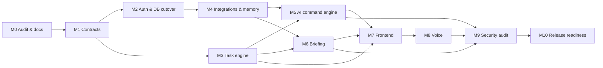

# 08 — Implementation Plan

Dependency-ordered plan. Status values: `todo`, `in-progress`, `done`
(verified, with evidence in `docs/11-progress.md`), `blocked`, `operator`
(needs a human with credentials or remote access).

Every task row below carries: **ID · Goal · Depends on · Files · Steps ·
Acceptance · Tests · Security · Verify · Status**. Shared verification commands:

```bash
pnpm typecheck        # tsc --noEmit
pnpm lint             # eslint, 0 errors
pnpm test             # vitest run (needs DATABASE_URL to local Postgres)
pnpm test:e2e         # playwright (needs built app + local Postgres)
pnpm build            # next build
```

## Workstreams and file ownership

Parallel work is split so no two workstreams edit the same files. Shared
contracts (`prisma/schema.prisma`, `lib/prisma.ts`, `lib/<domain>/types.ts`) are
owned by WS-1 and frozen before WS-2..WS-6 start; later schema changes go back
through WS-1.

| WS | Owner role | Owns (may edit) | Must not edit |
|----|-----------|------------------|---------------|
| WS-1 Data foundation | Backend & DB | `prisma/**`, `lib/prisma.ts`, `lib/tasks/**`, `lib/projects/**`, `lib/memory/**`, `lib/audit/**`, `lib/observability/**`, `lib/test/**`, `vitest.config.ts`, `package.json` (deps) | `app/**`, `components/**` |
| WS-2 Auth & security | Auth & Security | `lib/auth/**`, `lib/security/**`, `app/api/auth/**`, `middleware.ts`, `next.config.ts`, `app/(auth)/**` pages logic | task/AI modules |
| WS-3 Integrations | Integrations | `lib/integrations/**` | auth routes |
| WS-4 AI command engine | AI Orchestration | `lib/ai/**`, `lib/commands/**`, `app/api/command/**` | schema (request via WS-1) |
| WS-5 Briefing & jobs | Backend (jobs) | `lib/briefing/**`, `inngest/**`, `app/api/inngest/**`, `app/api/briefing/**` | AI command files |
| WS-6 Frontend, voice, landing | Frontend & Voice | `app/(app)/**`, `app/page.tsx`, `app/layout.tsx`, `app/globals.css`, `components/**`, `lib/hooks/**`, `lib/voice/**`, `app/api/tasks/**` (thin handlers over WS-1 repo) | `lib/tasks/**` internals |
| WS-7 QA | QA & Reliability | `e2e/**`, `playwright.config.ts`, acceptance tests | production code (report bugs) |
| WS-8 Independent security review | Security Reviewer | `docs/14-final-security-report.md` findings | production code (findings go back to owners) |



Reordering vs. the master roadmap: TASK-001 (schema) is pulled into M1 together
with ARCH-002 because every later workstream depends on the schema; AUTH-009/010
(cutover + removal of Drizzle/Auth.js) run after TASK-002 because the task
module is the largest Drizzle consumer.

---

## Milestone 0 — Repository and security baseline

| ID | Goal | Dep | Files | Acceptance | Status |
|----|------|-----|-------|-----------|--------|
| AUDIT-001 | Inspect git status/history | — | — | Branch, worktree, WIP, trailers documented in 01 | done |
| AUDIT-002 | Map architecture | 001 | docs/01 | Route + module map in 01 | done |
| AUDIT-003 | Inventory features/integrations | 002 | docs/01 | Feature table with works/incomplete | done |
| AUDIT-004 | Run tests/build safely | 001 | — | Results recorded (140/141, 6 env failures) | done |
| AUDIT-005 | Schema & auth drift | 002 | docs/01, 03 | Drizzle vs Prisma diff table | done |
| AUDIT-006 | Security baseline | 002 | docs/05, 06, 14 | Baseline findings SEC-B-* | done |
| AUDIT-007 | Planning/spec files | 001–006 | docs/00–14 | All 15 files exist, reviewed by lead | done |

## Milestone 1 — Architecture and contracts

| ID | Goal | Dep | Files | Steps | Acceptance | Tests | Security | Status |
|----|------|-----|-------|-------|-----------|-------|----------|--------|
| ARCH-001 | Module boundaries | M0 | docs/02, eslint.config.mjs | Add `no-restricted-imports` so only `lib/**/repo.ts` + `lib/auth/**` import `@/lib/prisma`; ban `@/db/*` | Lint fails on violations | lint | BOLA prevention | todo |
| ARCH-002 + TASK-001 | DB & ownership contracts; final schema | M0 | prisma/schema.prisma, prisma/migrations/* | Additive migration per docs/03; data-preserving notes→description, status mapping | `prisma migrate deploy` on fresh + on a DB seeded with old-shape rows both pass; integrity script passes | migration test `prisma/migrations.test.ts` | Unique/ownership constraints in DB | todo |
| ARCH-003 | Session contract | M0 | lib/auth/session.ts | `requireUser()` helper for routes/pages returning `{userId}` or 401/redirect | All protected handlers use it | unit | Single identity source | todo |
| ARCH-004 | AI tool contracts | M0 | lib/commands/types.ts | Zod schemas for proposals, results, API responses (docs/04) | Types compile, shared by UI | unit | Strict schemas | todo |
| ARCH-005 | Job contracts | M0 | lib/briefing/types.ts | Event payload schema `{userId, localDate}` validated at job entry | Malformed payload rejected | unit | Explicit user ctx | todo |
| ARCH-006 | Errors, logging, idempotency | M0 | lib/observability/logger.ts, lib/errors.ts | Structured JSON logger with redaction + correlation id; `AppError` taxonomy | Redaction test passes for tokens/passwords/emails bodies | unit | No secrets in logs | todo |
| ARCH-007 | Design system strategy | M0 | docs/07 | — | Tokens + component strategy agreed | — | — | done |

## Milestone 2 — Authentication and database cutover

| ID | Goal | Dep | Files | Acceptance | Tests | Status |
|----|------|-----|-------|-----------|-------|--------|
| AUTH-001 | Verify Prisma schema/migrations, adapter by URL (ADR-003) | ARCH-002 | lib/prisma.ts | Tests run on local Postgres | lib/prisma.test.ts | todo |
| AUTH-002 | Password auth complete | AUTH-001 | app/api/auth/login, signup | Login/sign-up/lockout tests green, timing-equalised | route tests | todo |
| AUTH-003 | OTP + recovery | AUTH-002 | otp, verify-otp, forgot/reset | Single-use, expiry, attempt caps, no enumeration | route tests | todo |
| AUTH-004 | Google & GitHub auth | AUTH-001 | google/github routes, lib/auth/*-oauth.ts | state + PKCE, verified-email linking only, tokens encrypted (ADR-011) | route tests | todo |
| AUTH-005 | Passkey register + sign-in | AUTH-001 | passkey routes | Challenge single-use, origin/RP ID, counter, UV required | route tests | todo |
| AUTH-006 | Auth rate limiting (ADR-012) | AUTH-001 | lib/security/auth-rate-limit.ts | 429 after threshold per IP and per email | unit + route | todo |
| AUTH-007 | Security audit events | AUTH-001 | lib/audit/auth-events.ts | Every auth outcome writes AuthEvent w/o secrets | route tests assert event | todo |
| AUTH-008 | Session rotation/revocation | AUTH-002 | session, logout route, sessions settings | Logout clears cookie; "sign out everywhere" bumps sessionVersion; password reset revokes | tests | todo |
| AUTH-009 | Cutover in safe env | AUTH-001..008, TASK-002 | — | All consumers on Prisma + getSession locally; remote = operator runbook | full suite | todo (remote: operator) |
| AUTH-010 | Remove Drizzle/Auth.js | AUTH-009 | db/, auth.ts, [...nextauth], persist-integration-account, drizzle.config.ts, package.json | No imports remain; build passes | build + lint | todo |
| AUTH-011 | Cross-user isolation tests | AUTH-010, TASK-002, AI-006 | tests/security/isolation.test.ts | Every repo fn + API + tool rejects foreign ids | integration | todo |

## Milestone 3 — Core data and task engine

| ID | Goal | Dep | Acceptance | Status |
|----|------|-----|-----------|--------|
| TASK-002 | Ownership-safe repo (`lib/tasks/repo.ts`) | TASK-001 | All writes `updateMany where {id,userId,version}`; not-found vs conflict distinguished | todo |
| TASK-003 | Priority, status, due date (+date-only) | 002 | Status transitions validated; due in user TZ | todo |
| TASK-004 | Subtasks & dependencies | 002 | Cycle prevention; parent completion rule documented | todo |
| TASK-005 | Recurrence & reminders | 003 | RRULE subset (DAILY/WEEKLY/MONTHLY, INTERVAL, BYDAY); completing generates next occurrence once (idempotent); DST-safe via TZ-aware arithmetic; missed occurrences roll forward to next future date | todo |
| TASK-006 | Search, filters, sorting, views | 002 | Views Today/Upcoming/Inbox/Overdue/Completed/All/Project; cursor pagination | todo |
| TASK-007 | Bulk actions & undo | 008 | Bulk requires confirmation token; undo replays inverse of TaskEvent within 10 min | todo |
| TASK-008 | History & audit | 002 | Every mutation writes TaskEvent in same transaction | todo |
| TASK-009 | Concurrency & idempotency tests | 002–008 | Double complete → one event, one next occurrence; concurrent edits → one conflict | todo |
| TASK-010 | Query performance | 006 | Indexes per docs/03; 10k-task fixture view query < 50 ms locally | todo |

## Milestone 4 — Integrations and personal context

| ID | Goal | Acceptance | Status |
|----|------|-----------|--------|
| INT-001 | Gmail OAuth scopes verified | Only gmail.readonly + gmail.compose + calendar.readonly + identity | todo |
| INT-002 | Secure Gmail search | Query length cap, result cap, bodies truncated & marked untrusted | todo |
| INT-003 | Draft creation + review | Draft only via confirmed proposal; never send; draft review UI | todo |
| INT-004 | Calendar read-only verified | No write scopes or calls | todo |
| INT-005 | Events + TZ | Range in user TZ; all-day events handled | todo |
| INT-006 | Refresh, revoke, reconnect | invalid_grant → account marked `needsReconnect`; UI shows reconnect | todo |
| MEM-001 | Memory store/retrieve on Prisma | raw SQL vector search user-scoped | todo |
| MEM-002 | Ownership, deletion, retention | Delete endpoint + UI; purge on account delete | todo |
| MEM-003 | Prompt-injection & leakage tests | Injected email text cannot cause executed mutation | todo |

## Milestone 5 — AI command engine

| ID | Goal | Acceptance | Status |
|----|------|-----------|--------|
| AI-001 | Typed tool registry (docs/04) | Every tool: in/out schema, limits, audit | todo |
| AI-002 | Intent & entity resolution | `resolve_task` returns candidates with scores | todo |
| AI-003 | Date parsing (ADR-008) | chrono-based resolver with prefs; table tests incl. DST | todo |
| AI-004 | Ambiguity & clarification | 3× "Finish report" → clarification with options; "move it" w/o antecedent → question | todo |
| AI-005 | Policy & confirmation gates | Policy matrix unit-tested | todo |
| AI-006 | Transactional idempotent execution | Replay of clientRequestId / proposalId does not re-apply | todo |
| AI-007 | Retries & structured errors | Provider timeout → error kind, no partial writes | todo |
| AI-008 | Prompt-injection tests | Tainted proposals never auto-execute | todo |
| AI-009 | E2E NL command tests | Mock model scripted tool calls cover the 10 example commands | todo |
| AI-010 | Metrics | latency, tokens, outcome stored on AgentRun | todo |

## Milestone 6 — Morning briefing

| ID | Goal | Acceptance | Status |
|----|------|-----------|--------|
| BRIEF-001 | TZ-aware schedule (ADR-010) | Scheduler picks users whose local time ≥ briefingHour | todo |
| BRIEF-002 | Fetch authorised context | Per-user token; Gmail/Calendar/tasks/memory/reminders | todo |
| BRIEF-003 | Grounded recommendations | Each item has sources; ungrounded dropped; isInferred flag | todo |
| BRIEF-004 | Persist results + status | BriefingRun + DailyBriefing | todo |
| BRIEF-005 | Idempotency, retries, recovery | Re-run same day is a no-op unless forced by operator | todo |
| BRIEF-006 | No duplicate/concurrent jobs | DB unique + Inngest concurrency key | todo |
| BRIEF-007 | Freshness indicators | Today shows generatedAt + stale (>12h or sources changed) | todo |
| BRIEF-008 | 8 AM acceptance scenario | Automated test passes | todo |

## Milestone 7 — Frontend

UI-001 tokens & fonts · UI-002 app shell (sidebar, header, ⌘K) · UI-003 Today +
briefing · UI-004 task list/filters/details · UI-005 upcoming/overdue · UI-006
command palette · UI-007 command results/confirm/clarify · UI-008 integrations &
settings (preferences, sessions, passkeys) · UI-009 empty/loading/error/
disconnected states · UI-010 motion + reduced motion · UI-011 responsive + a11y
(axe) · UI-012 remove dead controls · UI-013 landing page with Anatomy figures
(ADR-014). Acceptance for each: connected to real API, keyboard operable,
axe clean, reduced-motion honoured. Status: todo.

## Milestone 8 — Voice

VOICE-001 support matrix · 002 permission & states · 003 transcript review/edit
· 004 same pipeline · 005 optional speech output (off by default, stop button)
· 006 cancel/interrupt/errors · 007 keyboard alternative (hold `⌘⇧.`/button) ·
008 tests with mocked SpeechRecognition. Status: todo.

## Milestone 9 — Independent security audit

SEC-001..012 as in the master roadmap; findings tracked in
`docs/14-final-security-report.md`; every fix gets a regression test. Status: todo.

## Milestone 10 — Release readiness

REL-001 full suite · 002 build+typecheck · 003 migration+rollback verified on
local copy · 004 backup/recovery procedure (operator for Neon PITR) · 005 env
validation (`lib/env.ts` Zod) · 006 monitoring/job health endpoint · 007 UAT
checklist · 008 release-readiness report. Status: todo.
